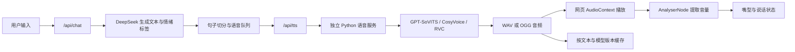

# Amadeus 后续迭代、原著素材与声音系统路线图

> 适用项目：`D:\Amadeus\experiments\v1.3` 及其后续版本  
> 初稿日期：2026-08-16；素材审阅与路线修订：2026-08-18  
> 目标：在不破坏现有世界线、Phone Trigger、实时天气时间和人物交互的基础上，把项目逐步扩展为更符合《STEINS;GATE》与《STEINS;GATE 0》氛围的个人学习作品。
> 素材索引：[`material/README.md`](../material/README.md)；原始扫描仅供本地研究，不进入公网构建。

## 1. 当前版本判断

v1.3 已经具备以下基础：

- α、β、Steins Gate 三种世界线状态；
- β 线 Amadeus 红莉栖和 Steins Gate 线生前红莉栖的独立人格；
- Phone Trigger、偏移率显示、世界线切换噪声；
- 时间和天气工具；
- 网页角色图像、眨眼、张嘴、点击动作；
- DeepSeek 文本回答；
- 浏览器 Web Speech API 朗读。

当前声音功能位于 `app/page.tsx`，使用 `SpeechSynthesisUtterance`。这意味着访问者听到什么音色取决于其操作系统和浏览器，服务器不能保证音色一致，也不能稳定表达“冷静、恼火、担心、害羞”等角色状态。后续声音系统不能继续只调 `pitch` 和 `rate`，而应改成独立的音频生成与播放链路。

### 1.1 2026-08-18 基线审计

本次规划不是只依据界面观感，而是同时核对了 v1.3 源码、数据库占位、自动测试和新增原著素材。

| 领域 | 已确认现状 | 对规划的影响 |
|---|---|---|
| 构建与测试 | `npm test` 中构建成功，但 3 项测试全部因 `worker.fetch is not a function` 失败；测试中还保留旧的 `raw` 世界线断言 | 在新增功能前先恢复可信测试基线，并统一 `alpha / beta / steins-gate` 命名 |
| 数据层 | `db/schema.ts` 为空；没有会话、事件、账号、关系或消息表 | 世界线、D-Mail、RINE、来电和长期记忆都必须先建立事件与持久化模型 |
| 会话状态 | 消息仅存在 React state；刷新后丢失。`localStorage` 只保存世界线 ID 和偏移率 | v1.4 先做可恢复会话和观测日志，不能直接跳到跨账号功能 |
| 世界线 | 前后端共享三个世界线定义，口令由服务端复核；但跃迁结果没有统一事件记录 | 保留现有一致性优点，把所有跃迁收口到一个服务端事务/事件入口 |
| Phone Trigger | 3 个静态来电写在前端，选择直接映射到三条世界线 | 目前是演示选择器，不是来电系统；需要来电实例、状态、记录和幂等处理 |
| 人物表现 | Canvas 整图动画；“说话”嘴型由状态和周期波形驱动，不是真实音频振幅，也不是 Live2D | 先定义受控表情状态与资产验收，再接入真实音频驱动和 Live2D |
| 声音 | 浏览器 Web Speech API，无统一音色、分句队列、缓存、授权记录或服务端回退 | 动态角色音色必须延后到授权、队列和故障回退均完成之后 |
| 原著素材 | `material/` 有 630 张扫描图和 1 份 PDF，共约 2.88 GiB，当前没有来源清单和公开使用门禁 | 素材只作本地研究；建立来源与权利状态后才允许产生项目衍生资产 |

**基线结论**：下一步不是立刻训练声音，而是完成 `v1.3.1` 的测试修复、状态命名统一、素材边界和事件模型。只有基线可重复验证，后续语音、记忆和消息分支才不会互相污染。

### 1.2 原著素材带来的产品修正

官方文档逐页 PNG 的文件号通常比印刷页码大 2；下表统一引用 PNG 文件号。

| 素材锚点 | 显示出的系统特征 | 对项目路线的修正 |
|---|---|---|
| `080-083.png` | 红莉栖/Amadeus 有多种表情、姿态和转面 | 人物系统增加受限表情枚举，文字、声音和动画共用同一 `expressionState` |
| `195-203.png` | RINE 以角色、时间和消息链组成可回看档案 | 先做只读消息档案与固定分支，再开放自由输入和跨账号通讯 |
| `220-223.png` | 偏移率与路线、日期、事件共同构成矩阵和时间轴 | 世界线升级为事件模型，不再只保存一个小数 |
| `224-226.png` | 地图与地点信息可以支撑调查路径 | v1.9 的任务系统以地点卡、线索卡和访问条件为骨架 |
| `228-230.png` | 组织关系、Amadeus 会话触发时机与表情相互关联 | 增加关系阶段、称呼、权限、情绪和触发条件的确定性状态机 |
| `231-233.png` | 手机终端、道具、Logo/Stamp 构成独立交互语言 | 建立原创终端组件和图标规范，不直接复制扫描资源 |
| `236-245.png` | Q&A 集中解释疑难设定 | 写剧情和人设前建立“待核对问题”流程，不让模型自行补全设定空白 |

这使项目目标从“带角色外观的聊天页”调整为“以聊天为入口的世界线档案终端”。声音仍重要，但不再是第一个大型里程碑。

### 1.3 2026-09-20 PRTS 视觉参考库重建

用户要求把这一版 Amadeus 改名为 **PRTS**，并按明日方舟近期公开视觉重新建立参考库。本次采用“公开样本观察 + 原创转译”的方式，不再用自制概念图替代资料研究，也不把官方页面图片、角色图、Logo 或拆包 UI 放进项目。

新的本地入口：[`design-reference/arknights-prts/`](../design-reference/arknights-prts/)

资源库覆盖多个近期样本，而不是只围绕七周年：2026 年 9 月「逐影集趣」、2026 年 9 月「月行水上」、2026 年 7 月制作组通讯 #67、2026 年 6 月两期《怪物猎人》联动、2026 年 4 月七周年、2026 年 1 月官方设定集 Vol.4 勘误、2025 年 11 月感谢庆典、2025 年 6 月制作组通讯 #54、2025 年 4 月巴别塔复刻与音律联觉主题，以及 Yostar Pictures 的 ARKNIGHTS PV 制作页。每项均在 `source-manifest.csv` 记录链接、日期、用途和 `rights_status`。

PRTS 变体的实现约束见 [`PRTS-variant-spec.md`](../design-reference/arknights-prts/PRTS-variant-spec.md)：保留 Amadeus 人物/世界线内核和锈蚀材质，但改用浅纸色基底、石墨正文、锈橙动作色与冷青连接色，采用“节点 → 卡片 → 详情”的信息层级，以及“未开放 / 进行中 / 已完成 / 可领取”的确定性状态。这里的 PRTS 是项目内部变体名，不声称是官方 PRTS，也不复制完整官方页面。用户提供的罗德岛 Logo 已单独登记为 `private-prototype-unverified`，只进入 `experiments/prts-v1` 本地预览，不进入公网版本。

**版本影响**：v1.5 的“人物与视觉状态”现在增加 PRTS 主题层、来源清单和素材门禁；任何新的界面组件必须先在参考库登记来源，再转译为原创 CSS、图标或纹理。未完成权利审查前，`material/` 和公开样本不得进入公开发行包或公网部署；罗德岛 Logo 是仅供本机预览的单项例外，不代表已获公开使用许可。

## 2. 迭代总原则

### 2.1 先保证世界线一致，再增加彩蛋

新增功能必须读取统一的 `worldLineId`，不能只改变界面文字。例如 β 线的 Amadeus 不应突然拥有与冈部共同度过实验室夏天的记忆；Steins Gate 线也不应把其他世界线发生的事情当成完整亲历记忆。世界线变化必须同时影响：

- 人格提示；
- 长期记忆档案；
- 对话历史的细微差异；
- 来电来源和内容；
- 角色声音、音频滤镜与称呼；
- 可见的世界线日志。

### 2.2 让用户发现影响，不直接解释机制

作品氛围更适合通过“记忆不一致、日志时间改变、称呼变化、来电内容变化”让用户自行发现世界线偏移，而不是弹窗说明“你已切换人格”。后台可以保存明确状态，前台只展示足够的线索。

### 2.3 先做确定性系统，再交给大模型发挥

世界线数值、D-Mail 后果、账号数据、通话结果和重要剧情节点应由代码和数据库决定。大模型负责自然语言表现，不能让模型自行决定是否已经发送 D-Mail、是否删除记忆或是否切换世界线。

## 3. 推荐版本路线

| 版本 | 核心目标 | 用户能看到的变化 | 主要技术 |
|---|---|---|---|
| v1.3.1 | 可靠基线 | 现有功能不回退，世界线命名和行为一致 | 修复 Worker 测试适配、更新陈旧断言、CI、错误日志 |
| v1.4 | 事件与档案内核 | 刷新后会话可恢复，可查看世界线观测日志和只读 RINE 档案原型 | 数据库迁移、统一 `transitionWorldLine()`、事件表、幂等键 |
| v1.5 | 人物与视觉状态 / PRTS 变体 | 红莉栖能以受控表情回应；PRTS 档案、地图和终端形成统一原创视觉语言 | `expressionState`、PRTS token、资产目录、来源清单、Canvas/Live2D 适配层 |
| v1.6 | 声音系统骨架 | 合法固定音色、音频队列、通话滤镜、嘴型跟随真实音量 | `/api/tts`、授权音源、Web Audio API、缓存与回退 |
| v1.7 | 世界线记忆引擎 | 切线后称呼、可访问资料和关键记忆发生可追溯改变 | 事件溯源、记忆键、摘要、关系状态机 |
| v1.8 | D-Mail / D-RINE | 用户发送受限消息并在未来看到固定规则产生的后果 | 消息队列、定时任务、分支规则、审计与滥用防护 |
| v1.9 | Amadeus 通话与调查终端 | 主动来电、通话记录、地点卡、Lab Memo、IBN 5100 线索任务 | SSE/通知、任务系统、地图/线索索引、原创资料库 |
| v2.0 | 账号和长期记忆 | 每个账号有独立 Amadeus 关系、记忆与 D-Mail | 登录、数据库、权限、向量检索、审计日志 |

### 3.1 版本门槛

每一阶段满足门槛后才能进入下一阶段：

1. **v1.3.1 门槛**：构建和自动测试全部通过；测试覆盖三个世界线口令、无 Key 演示模式、非法输入和历史截断；文档与代码不再出现旧 `raw` 命名。
2. **v1.4 门槛**：所有世界线变化只能由服务端统一入口写入；事件有唯一 ID、前后状态、触发源、时间和版本；重复请求不会造成二次跃迁。
3. **v1.5 门槛**：每项衍生视觉资产都有来源、用途和权利状态；原始扫描不出现在 `public/` 或发行包；表情状态由枚举控制且有降级图。
4. **v1.6 门槛**：只使用自制或获得授权的公开音源；语音服务关闭时文本与浏览器回退仍可工作；真实音量驱动嘴型不影响键盘操作和减少动画模式。
5. **v1.7 门槛**：模型不能直接写入事实状态；记忆差异、关系值和解锁项都由可测试规则产生，可查看原因并回滚到快照。
6. **v1.8 以后门槛**：跨账号或延迟消息上线前必须完成身份校验、限流、拉黑、举报、审计和隐私保留策略。

## 4. 符合原著氛围的功能清单与操作方式

原著素材只用于验证信息关系和设计方向，功能文案、图标、地图和界面必须原创。各功能的最小闭环如下：

| 功能 | 素材锚点（PNG 文件号） | 当前缺失 | MVP 验收 |
|---|---|---|---|
| 世界线观测档案 | `220-223` | 只有 `localStorage` 中的当前读数 | 至少记录一次来电跃迁和一次口令跃迁；可按时间回看前后状态与触发原因 |
| Reading Steiner 记忆差异 | `220-223`、`227` | 只有欢迎语和标签重构 | 3 个固定 `memory_key` 在三条世界线显示不同版本，且模型不能修改版本事实 |
| RINE / D-RINE | `195-203`、`232-233` | 无消息数据模型 | 先交付只读档案和 3 条固定分支；消息顺序、已读和解锁条件刷新后保持一致 |
| Amadeus 会话关系 | `080-083`、`230` | 无关系阶段、表情或触发次数 | 至少 4 个关系阶段；称呼、表情、可见记忆和固定事件由状态机决定 |
| 主动来电 | `230-231` | 前端 3 个静态来电直接切线 | 来电实例有 `scheduled/ringing/answered/declined/missed` 状态，重复点击只结算一次 |
| 地点调查与 IBN 5100 | `224-226` | 无地点、线索和任务模型 | 3 个原创地点、5 条线索、1 个可完成任务；未解锁答案不会进入模型上下文 |
| 组织与权限档案 | `228-229` | 无组织、角色权限或资料可见性 | 同一资料在不同世界线/关系阶段显示不同摘要，服务端校验访问条件 |
| 终端与图标规范 | `231-233` | 样式集中在页面，缺少资产来源/授权表 | 建立原创组件和图标清单；构建产物不含任何原始扫描页或直接裁切图 |

### 4.1 世界线观测档案

**用户操作**：点击辉光管仪表旁的 `OBSERVATION LOG`，查看曾经观测过的偏移率、发生时间和异常摘要。普通用户只能看到模糊描述，输入隐藏口令后显示更完整日志。

**实现步骤**：

1. 新建 `worldline_events` 表，保存 `id`、`user_id`、`from_line`、`to_line`、`divergence`、`trigger`、`created_at`。
2. 所有口令和 Phone Trigger 必须调用同一个 `transitionWorldLine()` 服务。
3. 切换时保存事件，不直接篡改旧记录。
4. 对话界面根据事件生成“时间戳错位、句子轻微不同、某条消息消失”等视觉结果。

### 4.2 Reading Steiner 记忆差异

**用户操作**：世界线跳变后出现短暂耳鸣、失真和日志重构。用户可在 `MEMORY DISCREPANCY` 中对比“自己记得的内容”和“当前世界线数据库记录”。

**实现步骤**：

1. 给重要记忆增加 `memory_key`，例如 `first_contact`、`phone_answer_01`。
2. 每条世界线保存一个不同版本，不让模型临时编造。
3. 切线时只重建相关记忆，不把全部聊天记录随机改写。
4. 让 Amadeus 对差异表现为疑惑、否认或无法访问，而不是直接讲解设定。

### 4.3 D-Mail

**用户操作**：在手机界面输入一条长度受限的信息，选择发送目标时间。发送后不立即展示结果；若满足剧情条件，下一次登录或指定时间发生世界线变化。

**实现步骤**：

1. 建立 `dmail_messages` 表，保存原文、目标时间、发送时间、状态和结果事件。
2. 第一阶段只做预先编写的 10～20 个可识别意图，例如“取消某次来电”“提醒过去保存文件”。
3. 使用规则把意图映射到固定后果，模型只负责把后果写成自然文本。
4. 无法识别的消息进入 `NO OBSERVABLE CHANGE`，不能让模型随意改写世界。
5. 为每次变动保存恢复点，便于调试和回滚。

### 4.4 D-RINE / 账号间通讯

**用户操作**：登录用户可以添加好友、发送普通消息；满足条件后解锁 D-RINE，可向另一个账号的“过去收件箱”投递延迟出现的信息。

**实现步骤**：

1. 先完成普通私信：用户、会话、成员、消息、已读状态。
2. 加入限流、举报、拉黑和敏感信息保护后，再开放 D-RINE。
3. D-RINE 不真正修改数据库历史，而是在目标账号时间线中插入一个带 `effective_at` 的事件。
4. 所有跨账号消息必须做权限校验，不能只靠前端隐藏按钮。

### 4.5 Amadeus 主动来电

**用户操作**：网站打开后可能收到 Amadeus 来电；接听、拒绝、稍后处理会影响后续称呼、记忆和世界线。错过来电会出现在通话记录中。

**实现步骤**：

1. 用事件表保存来电，不在每次刷新时随机生成。
2. 后端根据账号、世界线、上次登录时间和未完成事件决定是否来电。
3. 使用浏览器通知前必须由用户主动授予权限。
4. 来电语音优先播放预生成的高质量固定台词，进入自由对话后切换动态 TTS。

### 4.6 Lab Memo 与未来道具档案

**用户操作**：用户可查看实验记录、人物关系和虚构装置状态，并把某条对话保存为 `LAB MEMO`。

**实现步骤**：

1. 使用 Markdown 保存自制资料，不直接复制官方设定集大段内容。
2. 每篇资料增加 `worldLineVisibility` 和解锁条件。
3. 搜索结果根据当前世界线返回不同版本。
4. 用户保存的 Lab Memo 与官方风格资料分区显示，避免混淆。

### 4.7 IBN 5100 调查任务

**用户操作**：通过匿名论坛、地点线索和角色来电逐步解锁资料；正确组合线索后出现新的终端命令。

**实现步骤**：

1. 建立 `clues`、`user_clues`、`missions` 三张表。
2. 任务推进只依赖已取得线索，不让模型自行宣布完成。
3. 大模型负责根据已有线索给出符合人格的提示，但不能泄露未解锁答案。

### 4.8 匿名论坛与网络人格反差

**用户操作**：用户浏览项目内的虚构匿名论坛，偶尔发现疑似红莉栖发布的内容；对话中提及帖子可能触发她的掩饰或反驳。

**实现步骤**：

1. 使用完全自制帖子，避免复制原作台词。
2. 帖子与对话共享 `topic_key`，由后端决定 Amadeus 是否知道。
3. 人格只偶尔表现网络文化反差，不能每句话堆梗。

### 4.9 时间跳跃实验日志

**用户操作**：不是直接让用户真的回到过去，而是保存一个“记忆快照”，继续对话后允许恢复到该快照；恢复时当前分支被封存为实验记录。

**实现步骤**：

1. 快照保存对话摘要、世界线、关系值和事件版本，不保存不必要的完整模型上下文。
2. 恢复操作要求二次确认。
3. 原分支只读保留，便于比较，不做物理删除。

### 4.10 天气、时间与现实世界信息

**用户操作**：自然询问北京时间、某城市天气或日期；Amadeus 调用工具后用角色口吻回答。

**实现步骤**：

1. 保持“模型判断意图、服务端调用工具、模型组织答案”的结构。
2. 实时数据和人格提示分离，避免人设覆盖工具结果。
3. 后续增加新闻时，只允许可信来源并显示更新时间；不要让模型把旧知识当实时新闻。

## 5. 声音系统的目标架构



建议把声音拆成三层：

1. **界面音效库**：来电铃声、接通声、世界线噪声、终端按键声。全部使用自制或获得授权的音效。
2. **固定语音库**：登录、接听、拒接、系统错误、短问候等高频台词。可预生成，播放速度最快，质量最稳定。
3. **动态 TTS**：对 DeepSeek 的任意回答生成语音。延迟较高，需要句子切分、缓存与回退机制。

## 6. 关于“原著牧濑红莉栖声音”的权利边界

牧濑红莉栖的动画声音不仅是角色元素，也对应真实声优的可识别声音和表演。中国《民法典》第一千零二十三条规定，对自然人声音的保护参照肖像权保护；《著作权法》也保护视听作品、表演者及录音录像制作者的相关权益。

因此建议遵守以下边界：

- 只处理自己合法持有的、未受 DRM 保护的本地媒体；本文不提供破解流媒体或绕过 DRM 的方法。
- 个人本地学习样本、模型权重和输出不要上传网盘、模型社区或公开仓库。
- 未取得声优、版权方及相关权利人许可前，不应把高度仿真的模型作为公网网站的公开功能，也不要用于收费、广告、冒充声优或误导他人。
- 公网正式版本的安全方案是邀请获得授权的配音者录制原创语料，制作“符合角色气质但不复制特定真人身份”的项目专属音色。
- 网站应明确标注为非官方同人学习项目，并为合成音频加入可见提示或元数据标识。

以下采集与训练流程应视为**本地研究流程**。如果要放到 `ljq2333.fun` 公网使用，应先解决授权问题。

## 7. 如何从合法持有的本地视频建立声音库

### 7.1 目录结构

```text
D:\Amadeus\voice-lab\
├─ sources\                 # 合法持有的原始媒体，不提交 Git
├─ extracted\               # 从视频截取的原始 WAV
├─ separated\               # 分离人声后的候选文件
├─ clips\
│  ├─ neutral\
│  ├─ analytical\
│  ├─ annoyed\
│  ├─ concerned\
│  ├─ soft\
│  ├─ surprised\
│  └─ rejected\              # 有重叠、BGM 或失真的废片
├─ metadata\
│  ├─ kurisu.list
│  └─ catalog.csv
├─ models\                  # 本地模型权重，不提交 Git
├─ references\              # 推理时按情绪选择的参考音频
└─ tests\                   # 固定测试文本与输出
```

把 `voice-lab/sources`、`voice-lab/models`、训练日志和生成音频加入 `.gitignore`。

### 7.2 安装基础工具

Windows 可安装 FFmpeg 和 Audacity。FFmpeg 用于无损截取，Audacity 用于波形检查和人工修剪。

```powershell
winget install --id Gyan.FFmpeg
```

安装后检查媒体中的音轨：

```powershell
ffprobe -hide_banner "D:\Amadeus\voice-lab\sources\episode01.mkv"
```

只从本地文件截取指定时间段，不重新压缩：

```powershell
ffmpeg -ss 00:12:34.500 -to 00:12:40.200 `
  -i "D:\Amadeus\voice-lab\sources\episode01.mkv" `
  -map 0:a:0 -vn -ac 1 -ar 48000 -c:a pcm_s16le `
  "D:\Amadeus\voice-lab\extracted\ep01_001.wav"
```

`-map 0:a:0` 不一定是日语音轨，应根据 `ffprobe` 结果调整。

### 7.3 选择样本的标准

每个训练片段建议：

- 2～12 秒，一段只包含一句完整说话；
- 只有目标人物，不能有其他角色重叠；
- 优先选择没有背景音乐、环境声和混响的室内对白；
- 开头、结尾各保留约 0.1～0.25 秒自然静音；
- 不包含片头曲、片尾曲、尖叫、哭喊、电话滤镜或远距离喊话；
- 不使用已经严重压缩、爆音或削波的片段；
- 同一句的重复镜头只保留质量最好的一份。

如果不得不做人声分离，可使用 GPT-SoVITS 自带的 UVR5 工具或其他合法获取的 MDX/UVR 模型。分离会产生金属音、吞辅音和水声，处理后必须人工听一遍；原本就干净的对白永远优先于分离后的对白。

### 7.4 建议的数据量和情绪比例

官方 GPT-SoVITS 支持约 5 秒参考的零样本 TTS，也支持少量数据微调；但“能出声”不等于“稳定还原人物”。本项目建议先做 10～15 分钟清洁数据验证流程，再逐步整理到 40～60 分钟。

| 情绪 | 建议时长 | 用途 |
|---|---:|---|
| neutral | 10～15 分钟 | 普通问答、说明事实 |
| analytical | 8～12 分钟 | 科学解释、纠正逻辑 |
| annoyed | 6～10 分钟 | 吐槽、被叫外号、反驳 |
| concerned | 5～8 分钟 | 担心用户、风险提醒 |
| soft | 5～8 分钟 | 信任后较柔和的表达 |
| surprised | 3～5 分钟 | 来电、异常观测、意外 |

电话音、广播音和强混响片段不要混入主训练集。它们应作为单独参考库或在生成完成后用滤镜制作。

### 7.5 日语转写与元数据

可用 Whisper 或 faster-whisper 生成日语初稿，但必须人工校对角色名、专有名词、语气词和句尾。训练文本应记录实际发音，不要把字幕翻译文本当作日语原文。

`catalog.csv` 建议字段：

```csv
id,source,episode,start,end,transcript_ja,emotion,intensity,bgm,overlap,quality,permission
kr_0001,episode01.mkv,01,00:12:34.500,00:12:40.200,这里填写人工校对后的日语,analytical,0.6,false,false,A,local-research-only
```

GPT-SoVITS `.list` 格式：

```text
D:\Amadeus\voice-lab\clips\analytical\kr_0001.wav|kurisu|ja|人工校对后的日语文本
```

不要把未经校对的自动字幕直接用于训练。错误文本会造成漏字、重复、发音错误和节奏异常。

### 7.6 音频质量检查

每个文件至少检查：

- 是否只有目标人物；
- 是否存在 BGM、重叠对白、回声、降噪水声；
- 文本是否与实际发音完全一致；
- 情绪标签是否准确；
- 音量是否明显高于或低于其他样本；
- 是否存在长静音、削波和异常呼吸声。

按照“集数”划分训练集和测试集，不要把同一连续场景相邻片段随机分到两边，否则测试结果会虚高。保留一批永不参与训练的测试句，用来比较每个模型版本。

## 8. 模型选择

### 8.1 推荐结论

**本项目第一选择：GPT-SoVITS V4。** 先做零样本与少样本原型，再使用整理好的日语数据微调。它能直接从文本生成语音，支持中文和日语，V4 原生输出 48kHz，适合接入聊天网站。

**辅助选择：RVC。** 如果已有一条带有正确感情和节奏的源语音，RVC 更适合只转换音色。它不是文本转语音，需要先由真人或另一个 TTS 提供“表演”。

**后续服务化选择：CosyVoice3 0.5B。** 它适合研究多语言、流式生成和服务部署，但搭建、调优与显存管理比第一版 GPT-SoVITS 更复杂。

**快速验证选择：Seed-VC。** 用 1～30 秒参考音频即可做零样本声音转换，适合在投入整理几十分钟数据前判断样本质量和目标声音是否可行。

| 方案 | 类型 | 优点 | 局限 | 在本项目中的用途 |
|---|---|---|---|---|
| GPT-SoVITS V4 | TTS + 少样本微调 | 中文/日语、直接输入文本、音色相似度高、48kHz | 长句和跨语言仍需调参，参考音频影响情绪 | 动态回答主方案 |
| RVC | 声音转换 VC | 音色转换成熟、约 10 分钟干净语音即可起步、保留源表演节奏 | 不能直接把文本变成语音 | 把真人/基础 TTS 的表演转换为目标音色 |
| CosyVoice3 0.5B | 多语言 TTS | 流式、多语言、服务化能力完整 | 环境和部署更复杂，微调成本更高 | v1.7 以后对比实验 |
| Seed-VC | 零样本 VC | 无需先训练、支持短参考和实时转换 | 最终一致性未必胜过专门微调 | 数据集早期验证、参考音频筛选 |
| 浏览器 Web Speech | 系统 TTS | 无服务器成本、故障率低 | 音色不可控 | 语音服务失败时回退 |

## 9. 针对当前电脑的训练建议

当前电脑配置：RTX 4060 Laptop GPU，约 8GB 显存，16GB 系统内存，i7-14650HX。

建议：

- GPT-SoVITS V4 使用 FP16、batch size 1，从官方默认参数开始；
- 先用 10～15 分钟 A 级样本完成一次全流程，不要一开始整理全部剧集；
- 训练时关闭本地游戏、图像生成和其他占显存程序；
- 每隔少量 epoch 保存检查点，用同一组固定测试句盲听；
- 如果出现过拟合、金属音或吐字变差，优先回退检查数据，不要只增加训练轮数；
- 原始音频、处理后音频和模型权重均放在 D 盘，避免再次出现 C/D 两份来源。

现有阿里云 2核2G ECS 不适合运行这些语音模型。可选部署方式：

1. **学习阶段推荐**：本地 RTX 4060 运行语音服务，网站先在本地联调。
2. **朋友低频访问**：把常用台词预生成到网站服务器，动态回答暂时回退浏览器声音。
3. **正式动态语音**：租用国内 GPU 云主机单独运行 TTS，阿里云原 ECS 只反向代理和鉴权。

## 10. GPT-SoVITS V4 实操顺序

1. 从官方 GitHub 获取最新代码或 Windows 整合包，安装到 `D:\Amadeus\voice-lab\GPT-SoVITS`。
2. 下载官方 V4 预训练模型并放入官方文档指定目录。
3. 启动 `go-webui.bat` 或官方提供的 PowerShell 启动脚本。
4. 在数据处理页完成切片；降噪仅对确实有噪声的样本使用。
5. 导入人工校对后的 `.list` 标注文件。
6. 第一次训练完全使用默认微调参数，batch size 设为显存可以承受的最低值。
7. 分别保存 SoVITS 和 GPT 检查点，不要只保留最后一次。
8. 使用固定测试集比较：中文短句、日语短句、数字、英文缩写、长句、疑问句和情绪句。
9. 选出稳定版本后锁定为 `kurisu-gsv-v1`，不要每次更新都覆盖同名权重。
10. 建立只监听 `127.0.0.1` 的 Python API，网页后端通过内部地址调用，模型服务不直接暴露公网。

训练质量主要由数据决定。不要把“更多片段”等同于“更好”：20 分钟完全干净、标注准确的片段通常比 2 小时混有 BGM、重叠对白和错误字幕的数据更可靠。

## 11. 情绪声音库与世界线差异

动态语音不能只使用一个参考片段。建议建立参考索引：

```json
{
  "beta": {
    "neutral": "references/beta_neutral.wav",
    "analytical": "references/beta_analytical.wav",
    "annoyed": "references/beta_annoyed.wav",
    "concerned": "references/beta_concerned.wav"
  },
  "steins-gate": {
    "neutral": "references/sg_neutral.wav",
    "soft": "references/sg_soft.wav",
    "surprised": "references/sg_surprised.wav"
  }
}
```

β 线和 Steins Gate 线可以使用同一基础音色模型，但后处理与情绪策略不同：

- β Amadeus：语气更克制，通话时加入非常轻微的带宽限制、连接底噪和偶发数字失真；不能把声音处理得像廉价机器人。
- Steins Gate 红莉栖：使用干净、近距离的人声，不添加 Amadeus 通讯滤镜。
- α 原始模型：使用中性 TTS 或浏览器声音，避免与两套角色人格混淆。

DeepSeek 返回值可以扩展为：

```json
{
  "reply": "回答文本",
  "speech": {
    "emotion": "analytical",
    "intensity": 0.55
  }
}
```

`emotion` 必须限制在固定枚举中。模型只能选择情绪，不能自行填写模型路径、命令或任意服务器参数。

## 12. 网站接入步骤

### 12.1 新增后端接口

新建：

```text
app/api/tts/route.ts
```

请求格式：

```json
{
  "text": "需要朗读的回答",
  "worldLine": "beta",
  "emotion": "analytical",
  "voiceVersion": "kurisu-gsv-v1"
}
```

后端操作：

1. 校验文本长度、世界线和情绪枚举；
2. 计算 `SHA-256(text + worldLine + emotion + voiceVersion)`；
3. 如果缓存存在，直接返回；
4. 否则调用本机或内网 Python TTS 服务；
5. 把 WAV 转为体积较小的 OGG/Opus；
6. 返回音频并写入缓存；
7. 设置频率限制，防止 API 被恶意消耗显卡。

### 12.2 前端播放队列

把当前 `speak(text)` 替换为：

1. 按中文句号、问号、感叹号和换行切句；
2. 第一段立即请求语音，后续段落并行预取；
3. 使用一个 `AudioQueue` 顺序播放；
4. 用户发送新问题时中止旧请求并清空队列；
5. TTS 超时则回退 `SpeechSynthesisUtterance`；
6. 页面隐藏或用户静音后停止播放，避免后台突然出声。

### 12.3 用真实音频驱动嘴型

不要再按固定计时器切换张嘴图。使用 `AudioContext.createAnalyser()` 获取当前音频振幅：

- 静音：闭口；
- 低振幅：小开口；
- 中振幅：中开口；
- 高振幅：大开口；
- 对 RMS 做约 60～120ms 平滑，避免嘴部抖动；
- 动画帧和音频播放使用同一个 `requestAnimationFrame` 循环。

以后如果素材允许，可增加 A/I/U/E/O 五种口型，但当前整图动画更适合先做三档开口，避免错位重新出现。

## 13. 固定语音库的优先清单

在动态 TTS 完成前，先准备以下自制或获得授权的固定语音：

- 登录成功；
- 通讯连接建立；
- 普通问候；
- 接听、拒接、稍后；
- 网络中断；
- 世界线读数异常；
- 无法访问记忆；
- 正在思考；
- 用户长时间无响应；
- 切换 β / Steins Gate 后的第一句自然回应。

命名示例：

```text
public/audio/voice/kurisu-gsv-v1/beta/call_answer_01.ogg
public/audio/voice/kurisu-gsv-v1/sg/login_01.ogg
public/audio/sfx/worldline_shift_01.ogg
```

固定语音通过事件 ID 调用，不要把文件名写死在多个 React 组件中。建立统一的 `audioCatalog.ts`。

## 14. 质量验收标准

先执行项目级门槛，再执行语音专项验收：

| 项目指标 | 最低门槛 |
|---|---|
| 构建与自动测试 | `npm test` 全部通过；不得用跳过失败用例作为发布条件 |
| 世界线一致性 | UI、服务端、人设、记忆和事件日志读取同一 `worldLineId`；不出现旧 `raw` 命名 |
| 事件幂等性 | 同一个 `idempotency_key` 重放不会重复发送消息、重复来电结算或二次跃迁 |
| 持久化 | 刷新/重启后会话摘要、世界线、关系阶段和未处理事件可以恢复 |
| 模型权限 | 大模型只能选择受限枚举和生成措辞，不能直接改数据库事实或解锁内容 |
| 素材合规 | 原始扫描不进入 `public/`、构建产物或发行包；每个衍生资产有来源和权利状态 |
| 可访问性 | 键盘可完成聊天、来电与档案操作；`prefers-reduced-motion` 下不强制播放失真和大幅动画 |
| 故障降级 | 回答、天气、语音或通知任一外部服务失败时，其余核心功能仍可使用 |

每次语音训练版本使用同一组测试文本并记录：

| 指标 | 建议目标 |
|---|---|
| 首句开始播放延迟 | 本地小于 2.5 秒 |
| 分句之间空隙 | 小于 300ms，且不截断呼吸 |
| 嘴型与音频偏差 | 感知上小于约 100ms |
| 中文可懂度 | 盲听无需字幕可理解绝大多数句子 |
| 日语自然度 | 专有名词、长音、促音无明显错误 |
| 音色一致性 | 不同情绪仍被认为是同一个说话者 |
| 伪影率 | 固定测试集不出现持续金属音、重复和吞字 |
| 故障回退 | TTS 服务关闭后文本回答仍可正常显示 |

建立 `tests/voice-evaluation.md`，每个模型版本保留试听评分，不要仅凭训练 loss 决定哪一个更好。

## 15. 数据安全与部署要求

- `material/`、未授权衍生图和本地研究笔记不进入 `public/`、静态资源清单或发行压缩包；
- 为每个衍生视觉/声音资产记录 `source_path`、用途、权利状态和审核时间；
- 训练素材、参考声音和权重不进入公开 Git 仓库；
- `/api/tts` 只接受网站后端请求，设置令牌、限流和文本长度限制；
- 缓存只保存生成音频的哈希文件名，不在 URL 暴露用户问题；
- 对账号私人消息默认不永久保存生成音频；
- 数据库迁移前保留可验证备份；用户消息、生成音频和审计日志分别设置保留期；
- 记录模型版本，发现问题时可以回退；
- 公网使用前完成版权和声音授权审查；
- 明确标注合成语音，禁止把输出用于冒充声优本人。

## 16. 推荐的实际执行顺序

1. **冻结 v1.3.1 基线**：修复测试导入/Worker 适配，更新旧 `raw` 断言，补齐三个世界线和输入校验测试，确保 `npm test` 全绿。
2. **建立领域模型**：定义 `worldline_events`、`conversations`、`messages`、`relationship_states`、`content_unlocks` 和迁移/回滚策略。
3. **统一世界线入口**：口令和 Phone Trigger 都调用服务端 `transitionWorldLine()`；加入事务、幂等键和审计字段。
4. **交付 v1.4 可见闭环**：会话可恢复、观测日志可查看、只读 RINE 档案有 3 条固定分支；先不做跨账号发送。
5. **建立衍生素材门禁**：按 [`material/README.md`](../material/README.md) 创建来源清单；任何上站图片先确认不是原始扫描或直接裁切。
6. **交付 v1.5 人物状态**：用 6 个受控表情状态驱动文本标签、Canvas/Live2D 和未来语音；没有对应资产时可靠降级到 `neutral`。
7. **先用授权音色搭 v1.6 骨架**：实现 `/api/tts`、分句队列、取消、缓存、限流、Web Speech 回退和真实音量嘴型，不立即训练或公网开放高仿角色声音。
8. **再做本地声音研究**：创建 `D:\Amadeus\voice-lab`；只整理 10～15 分钟合法持有且干净的样本，手工标注 4 个基础情绪并完成固定测试集盲听。
9. **交付 v1.7 记忆引擎**：先为 3 个 `memory_key`、4 个关系阶段和 2 个世界线事件做确定性规则，再扩大内容量。
10. **交付 v1.8 受限消息**：先做固定意图、延迟出现和可回放后果；权限、限流、举报、拉黑与审计完成后才考虑跨账号 D-RINE。
11. **交付 v1.9 通话与调查**：把来电状态机、地点卡、线索卡和 Lab Memo 接到同一事件内核，避免出现第二套剧情状态。
12. **授权后再公开**：只有角色图、声音、训练权重和衍生设计均通过权利审核，才考虑公网 GPU 动态语音或高相似度角色资产。

## 17. 参考资料

### 本地素材与检索入口

- [`material/README.md`](../material/README.md)：本次建立的素材清单、页段地图、权威层级和使用边界。
- [`Steins Gate 0 Official Document Amadeus' Script.pdf`](<../material/Steins Gate 0 Official Document Amadeus' Script.pdf>)：设定与系统结构主副本；仅限本地研究，不随项目发布。
- `material/Steins Gate 0 Official Document Amadeus' Script/`：274 页逐页 PNG 工作副本；引用时同时记录文件号和可见印刷页码。

本地扫描资料是研究依据，不是可直接复制到产品中的素材授权。

### 原作与功能设定

- [《STEINS;GATE 0》官方 STORY](https://steinsgate0.jp/story/)
- [《STEINS;GATE 0》官方 GAME：Amadeus 手机通讯](https://steinsgate0.jp/game/)
- [《STEINS;GATE》官方站](https://steinsgate.jp/)
- [《STEINS;GATE RE:BOOT》官方角色与作品介绍](https://steinsgate.jp/reboot/ja-jp/)

### 语音模型官方项目

- [GPT-SoVITS](https://github.com/RVC-Boss/GPT-SoVITS)
- [RVC WebUI](https://github.com/RVC-Project/Retrieval-based-Voice-Conversion-WebUI)
- [CosyVoice](https://github.com/QwenAudio/CosyVoice)
- [Seed-VC](https://github.com/Plachtaa/seed-vc)
- [OpenAI Whisper](https://github.com/openai/whisper)
- [faster-whisper](https://github.com/SYSTRAN/faster-whisper)

### 权利与合规

- [《中华人民共和国民法典》全文——中央网信办](https://www.cac.gov.cn/2020-06/01/c_15925617772683193.htm)
- [《中华人民共和国著作权法》——中国人大网](https://www.npc.gov.cn/c2/c30834/202011/t20201119_308796.html)
- [信息网络传播权保护条例](https://www.itsec.gov.cn/fgbz/xgfg/201711/t20171130_17941.html)

---

本路线图用于个人学习与工程规划，不构成法律意见。涉及原作音频、角色形象、声优声音或公开传播时，应以取得相关权利人的明确授权为前提。
