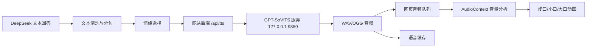

# Amadeus 声音系统从零到上线全套攻略

> 项目位置：`D:\Amadeus`  
> 当前项目版本：`D:\Amadeus\experiments\v1.3`  
> 目标硬件：RTX 4060 Laptop GPU（约 8GB 显存）、16GB 内存、Windows  
> 编写日期：2026-08-16  
> 本文目标：完成“合法素材管理 → 声音库整理 → GPT-SoVITS 训练 → 本地语音 API → 网页播放 → 嘴型同步 → 缓存与回退 → 云端方案”的完整闭环。

## 0. 先读结论

Amadeus 现有声音来自浏览器 `SpeechSynthesisUtterance`，不同访问者会听到不同音色。真正固定角色声线需要新增一套独立系统：



推荐分三阶段推进：

1. **第一阶段：固定语音库**。先让登录、来电、接听、错误、世界线变化等事件使用固定音频，验证播放和嘴型系统。
2. **第二阶段：动态 TTS**。接入 GPT-SoVITS，把任意回答变成固定声线。
3. **第三阶段：情绪与世界线差异**。β Amadeus 使用克制语气和轻微通讯滤镜；Steins Gate 红莉栖使用干净人声；α 使用中性音色或浏览器回退。

模型选择建议：

- 干净样本和高质量参考音频：优先测试 **GPT-SoVITS V4**，原生 48kHz。
- 从番剧截取、平均音质一般：同时测试 **GPT-SoVITS V2Pro**。官方说明其对平均质量较低的训练集更宽容。
- 已有一条情绪和节奏正确的源语音，只需要转换音色：测试 **RVC**。
- 在正式整理数据前做零样本可行性验证：测试 **Seed-VC**。

不要一开始整理几十集素材。先做 10～15 分钟最干净的数据，完成一次全流程后再扩充。

## 1. 权利、公开使用与安全边界

角色声音来自真实声优的可识别表演。训练数据还可能包含动画视听作品和录音录像制品中的受保护内容。个人本地研究不等于获得公网传播和商业使用许可。

必须遵守：

- 只处理自己合法持有的本地媒体；
- 不破解流媒体、不绕过 DRM，本攻略不包含这些操作；
- 原始音轨、切片、转写、参考音频、模型权重和生成音频不进入公开 Git；
- 未取得声优、动画版权方、录音录像制作者等相关权利人许可前，不把高度仿真的声音模型作为公网公开功能；
- 不把生成结果用于冒充声优本人、广告代言、收费服务或误导性内容；
- 公网正式方案应使用获得授权的配音者，制作“符合角色气质、但不复制特定自然人身份”的原创项目音色；
- 网站显示“非官方同人学习项目”和“语音为合成音频”提示。

中国《民法典》第一千零二十三条规定，对自然人声音的保护参照肖像权保护；《著作权法》同时涉及作品、表演者和录音录像制作者权益。本文是工程攻略，不构成法律意见。

## 2. 完成后的系统应是什么样

### 2.1 三类音频资产

#### A. 训练声音库

用于训练模型，不直接给网页访问者下载：

- 清洁语音切片；
- 日语逐字转写；
- 情绪、强度、音质、来源元数据；
- 训练集、验证集、测试集划分；
- GPT 与 SoVITS 检查点。

#### B. 推理参考声音库

GPT-SoVITS 每次生成时用于确定说话风格：

- β/neutral；
- β/analytical；
- β/annoyed；
- β/concerned；
- SG/neutral；
- SG/soft；
- SG/surprised。

每个参考音频只保留一个说话者、一句完整语音和准确日语文本。

#### C. 网站播放声音库

用于立即播放：

- 登录和连接固定台词；
- Phone Trigger 铃声、接听、拒接、稍后；
- 网络错误和服务降级；
- 世界线变化和 Reading Steiner 音效；
- 动态 TTS 缓存。

### 2.2 世界线声音规则

| 世界线 | 人格 | 音色策略 | 后处理 |
|---|---|---|---|
| α | 原始模型 | 中性系统音或浏览器 TTS | 无角色滤镜 |
| β | Amadeus 红莉栖 | 角色基础音色，表达更克制 | 轻微通讯带宽、极低数字底噪 |
| Steins Gate | 生前红莉栖 | 同基础音色，情绪更自然直接 | 干净近距离人声 |

不要为 β 使用夸张机器人音。Amadeus 的差异应主要来自说话方式和非常轻微的终端质感。

## 3. D 盘唯一目录规划

创建：

```text
D:\Amadeus\voice-lab\
├─ README.md
├─ sources\                    # 合法持有的原始本地视频/音频
├─ extracted\                  # 从视频截取的长音频
├─ separated\                  # 人声分离结果
├─ clips\
│  ├─ accepted\
│  │  ├─ neutral\
│  │  ├─ analytical\
│  │  ├─ annoyed\
│  │  ├─ concerned\
│  │  ├─ soft\
│  │  └─ surprised\
│  └─ rejected\                # 有重叠、BGM、噪声或错误的废片
├─ metadata\
│  ├─ catalog.csv
│  ├─ kurisu.list
│  ├─ train.list
│  ├─ validation.list
│  └─ test.list
├─ references\                 # 推理参考声音
├─ models\
│  ├─ experiments\
│  └─ production\
├─ generated\                  # 离线试听结果
├─ evaluation\
├─ tools\
└─ GPT-SoVITS\                 # 官方程序
```

创建目录的 PowerShell 命令：

```powershell
$root = "D:\Amadeus\voice-lab"
$dirs = @(
  "sources", "extracted", "separated",
  "clips\accepted\neutral", "clips\accepted\analytical",
  "clips\accepted\annoyed", "clips\accepted\concerned",
  "clips\accepted\soft", "clips\accepted\surprised",
  "clips\rejected", "metadata", "references",
  "models\experiments", "models\production",
  "generated", "evaluation", "tools"
)
New-Item -ItemType Directory -Path $root -Force
$dirs | ForEach-Object {
  New-Item -ItemType Directory -Path (Join-Path $root $_) -Force
}
```

在 `D:\Amadeus\.gitignore` 中加入：

```gitignore
voice-lab/sources/
voice-lab/extracted/
voice-lab/separated/
voice-lab/clips/
voice-lab/references/
voice-lab/models/
voice-lab/generated/
voice-lab/GPT-SoVITS/
voice-lab/**/*.wav
voice-lab/**/*.flac
voice-lab/**/*.ogg
voice-lab/**/*.mp3
voice-lab/**/*.ckpt
voice-lab/**/*.pth
voice-lab/**/*.index
```

注意：本攻略现在只是文档，执行上述命令和修改 `.gitignore` 应在正式开始声音实验时进行。

## 4. 安装基础工具

### 4.1 检查显卡

```powershell
nvidia-smi
```

应能看到 NVIDIA RTX 4060 Laptop GPU 和约 8GB 显存。如果命令不存在或显示驱动错误，先更新 NVIDIA 驱动。

### 4.2 安装 Git、FFmpeg 与 Miniconda

```powershell
winget install --id Git.Git
winget install --id Gyan.FFmpeg
```

安装 Miniconda 后重新打开 PowerShell，检查：

```powershell
git --version
ffmpeg -version
ffprobe -version
conda --version
```

Audacity 用于人工听音、修剪和波形检查，可从官方渠道安装。

### 4.3 安装 GPT-SoVITS 的两种方式

#### 方式一：Windows 整合包，推荐新手

1. 从 GPT-SoVITS 官方 GitHub README 的 Windows Integrated Package 链接下载；
2. 解压到 `D:\Amadeus\voice-lab\GPT-SoVITS`；
3. 双击 `go-webui.bat`；
4. 浏览器打开 WebUI；
5. 如果整合包没有 V4/V2Pro 权重，按照官方 README 下载对应预训练模型。

#### 方式二：源码安装，适合后续维护

```powershell
cd D:\Amadeus\voice-lab
git clone https://github.com/RVC-Boss/GPT-SoVITS.git
cd GPT-SoVITS

conda create -n GPTSoVits python=3.10 -y
conda activate GPTSoVits

pwsh -F install.ps1 --Device CU126 --Source ModelScope --DownloadUVR5
```

官方安装器当前支持选择 CUDA 与模型来源。身处中国时优先使用 `ModelScope` 或官方支持的镜像来源。如果当前官方脚本参数有变化，以仓库 README 为准。

启动：

```powershell
conda activate GPTSoVits
cd D:\Amadeus\voice-lab\GPT-SoVITS
python webui.py zh_CN
```

如果 `zh_CN` 参数不被当前版本接受，直接运行：

```powershell
python webui.py
```

## 5. 从合法本地视频提取声音

### 5.1 不要直接拿整集训练

整集音轨包含：

- 其他角色；
- 背景音乐；
- 环境声和混响；
- 远距离说话；
- 电话与电视滤镜；
- 尖叫、哭喊和重叠对白。

它们会使模型音色不稳定、吞字、产生金属音，甚至学进其他角色声线。

### 5.2 查看音轨

```powershell
ffprobe -hide_banner "D:\Amadeus\voice-lab\sources\episode01.mkv"
```

记录日语音轨编号。例如输出显示日语为 `Stream #0:2`，FFmpeg 映射就是 `-map 0:2`。

### 5.3 截取候选片段

```powershell
ffmpeg -ss 00:12:34.500 -to 00:12:42.000 `
  -i "D:\Amadeus\voice-lab\sources\episode01.mkv" `
  -map 0:2 -vn -ac 1 -ar 48000 -c:a pcm_s16le `
  "D:\Amadeus\voice-lab\extracted\ep01_scene_001.wav"
```

参数含义：

- `-ss`：开始时间；
- `-to`：结束时间；
- `-map 0:2`：选择音轨；
- `-vn`：不输出视频；
- `-ac 1`：单声道；
- `-ar 48000`：48kHz；
- `pcm_s16le`：16bit 无损 WAV。

不要反复把 MP3 转来转去。主存档统一保存 WAV，网页发布时再转换 OGG/Opus。

### 5.4 批量截取表

先建立 `metadata/extract-plan.csv`：

```csv
id,file,audio_map,start,end,emotion,notes
kr_0001,episode01.mkv,0:2,00:12:34.500,00:12:42.000,analytical,单人室内对白
kr_0002,episode01.mkv,0:2,00:18:01.200,00:18:07.500,annoyed,无背景音乐
```

初期建议手动执行，熟悉音轨和片段质量后再写批处理脚本。不要在未试听时自动截取整季。

## 6. 人声分离和去噪

### 6.1 优先级

1. 原本就干净的单人对白；
2. 只有轻微固定环境声的对白；
3. 可通过 UVR5 较好分离的对白；
4. 有明显 BGM、重叠对白、强混响的片段直接拒绝。

### 6.2 使用 GPT-SoVITS 的 UVR5

在 WebUI 打开 UVR5/人声伴奏分离模块：

1. 输入 `extracted` 目录；
2. 输出到 `separated`；
3. 对同一片段测试 2～3 个分离模型；
4. 保存人声结果；
5. 用耳机试听原始片段和分离结果。

出现以下问题就不要使用：

- 辅音消失；
- 声音像在水下；
- 高频出现细碎金属声；
- 呼吸被切断；
- BGM 虽消失但人声变空洞；
- 其他角色声线仍然存在。

### 6.3 降噪规则

- 不要对所有文件统一强降噪；
- 轻微底噪通常比降噪伪影更容易被模型容忍；
- 不做自动音高修正；
- 不增加混响；
- 不把电话音频均衡成普通人声后混进主训练集。

## 7. 切片标准

### 7.1 合格片段

- 2～12 秒；
- 一句完整、自然的语音；
- 单一说话者；
- 无明显 BGM 和重叠对白；
- 开头与结尾保留约 0.1～0.25 秒自然静音；
- 不在单词或气息中间切断；
- 音量正常、无爆音、无削波；
- 文本可以被准确转写。

### 7.2 拒绝片段

- 两人同时说话；
- 大声尖叫、哭喊、喘息占主要部分；
- 电话、电视、广播、远距离和大混响；
- 配乐盖过人声；
- 分离后有明显金属或水声；
- 极短语气词，无法提供稳定音色；
- 重复镜头或同一句的低质量版本。

### 7.3 自动切片只做初稿

GPT-SoVITS WebUI 可自动切片，但必须人工复查。推荐先使用保守参数，使单片约 3～10 秒。阈值、最短长度等参数应根据实际音量调整，不要照搬网络上的万能值。

## 8. 情绪分类与数量规划

先完成最小数据集：

| 类别 | 最小验证量 | 推荐正式量 | 典型用途 |
|---|---:|---:|---|
| neutral | 3 分钟 | 10～15 分钟 | 普通回答 |
| analytical | 3 分钟 | 8～12 分钟 | 科学分析、纠错 |
| annoyed | 2 分钟 | 6～10 分钟 | 吐槽、反驳 |
| concerned | 1 分钟 | 5～8 分钟 | 风险提醒、关心 |
| soft | 1 分钟 | 5～8 分钟 | 信任后的柔和表达 |
| surprised | 30 秒 | 3～5 分钟 | 来电、异常观测 |

不要为了凑时长加入低质量数据。质量优先级高于数量。

情绪强度建议用 `0.0～1.0`：

- `0.2`：非常克制；
- `0.4`：普通；
- `0.6`：明显情绪；
- `0.8`：强烈，但仍是正常说话；
- `1.0`：极端表演，不建议进入普通 TTS 参考库。

## 9. 转写与标注

### 9.1 自动生成日语转写初稿

GPT-SoVITS 已集成 Faster Whisper 日语/英语 ASR。可在 WebUI 的 ASR 页面选择日语，或在源码环境执行官方脚本：

```powershell
conda activate GPTSoVits
cd D:\Amadeus\voice-lab\GPT-SoVITS
python .\tools\asr\fasterwhisper_asr.py `
  -i "D:\Amadeus\voice-lab\clips\accepted" `
  -o "D:\Amadeus\voice-lab\metadata\asr" `
  -l ja `
  -p float16
```

具体参数以当前仓库脚本的 `--help` 为准：

```powershell
python .\tools\asr\fasterwhisper_asr.py --help
```

### 9.2 必须人工校对

逐条检查：

- 假名、汉字和长音；
- 促音、小写假名；
- 人名、学校名和专有名词；
- 语气词和停顿；
- ASR 是否把背景声识别成文字；
- 实际发音与字幕是否不同。

不要用中文字幕替代日语转写。参考音频的 `prompt_text` 必须与实际日语发音一致。

### 9.3 主目录元数据

`metadata/catalog.csv`：

```csv
id,path,source,episode,start,end,transcript_ja,emotion,intensity,bgm,overlap,artifact,quality,split,permission
kr_0001,D:/Amadeus/voice-lab/clips/accepted/analytical/kr_0001.wav,episode01.mkv,01,00:12:34.500,00:12:40.200,人工校对后的日语,analytical,0.55,false,false,false,A,train,local-research-only
```

字段说明：

- `quality=A`：干净，可用于训练和参考；
- `quality=B`：轻微噪声，只用于扩充训练；
- `quality=C`：不用于训练；
- `split`：`train`、`validation` 或 `test`；
- `permission`：记录授权范围，避免以后忘记来源。

### 9.4 GPT-SoVITS `.list`

格式：

```text
音频绝对路径|说话人名称|语言|文本
```

示例：

```text
D:\Amadeus\voice-lab\clips\accepted\neutral\kr_0001.wav|kurisu|ja|人工校对后的日语文本
```

UTF-8 保存，路径中不要混入不可见字符。

## 10. 训练集、验证集和测试集

推荐比例：

- 训练集：80%；
- 验证集：10%；
- 测试集：10%。

不要随机拆分同一连续场景。按集数或场景拆分，避免相邻片段同时进入训练集和测试集。

测试集必须包含：

- 普通日语句；
- 普通中文句；
- 问句；
- 长句；
- 数字和日期；
- 英文缩写；
- 科学术语；
- 轻微恼火和关心两种情绪。

固定测试文本不要随模型版本改变，否则无法公平比较。

## 11. 先做零样本基线

训练前先测试 5～10 秒 A 级参考音频：

1. 启动 GPT-SoVITS 推理 WebUI；
2. 选择 V4 或 V2Pro 预训练模型；
3. 上传参考音频；
4. 填写完全匹配的日语参考文本；
5. `prompt_lang` 选择 `ja`；
6. 测试文本语言分别选择 `ja` 和 `zh`；
7. 保存结果到 `generated/baseline-zero-shot`；
8. 至少测试 5 个不同参考片段。

如果零样本结果完全不像、辅音严重错误或参考片段有明显伪影，先换参考音频，不要急着训练。

## 12. V4 与 V2Pro 的 A/B 决策

### 12.1 V4

特点：

- 原生 48kHz 输出；
- 修复 V3 非整数倍上采样导致的部分金属音；
- 更依赖参考音频表现；
- 适合干净、高质量参考音频和最终网页播放。

### 12.2 V2Pro

特点：

- 官方说明性能超过 V4，但显存占用略高；
- 对平均音质较低的训练集更宽容；
- 番剧截取素材可能更适合作为第一套基线。

### 12.3 决策方法

使用相同的：

- 10～15 分钟训练数据；
- 训练/验证划分；
- 参考音频；
- 20 条测试文本；
- 盲听评分表。

不要只比较单条“最好听”的结果。比较稳定性、中文可懂度、音色一致性和伪影率。

## 13. 正式微调流程

GPT-SoVITS WebUI 的页面会随版本变化，但完整流程不变。

### 13.1 数据处理

1. 输入音频目录；
2. 自动切片；
3. 可选降噪；
4. 日语 ASR；
5. 人工校对标注；
6. 生成训练 `.list`；
7. 运行数据集预处理：文本、SSL 特征、语义特征。

任一步骤报错都不要跳过。确认预处理输出数量与有效音频数量一致。

### 13.2 SoVITS 微调

在 8GB 显存上：

- 使用 FP16；
- batch size 从 1 开始；
- 不同时运行图像生成、游戏或其他 CUDA 程序；
- 使用官方对应版本的预训练底模；
- 保存多个阶段检查点；
- 第一次使用默认学习率和默认 epoch。

### 13.3 GPT 微调

- 与 SoVITS 使用同一版本数据；
- 不混用 V4、V2Pro 的不兼容权重；
- 第一次保持默认参数；
- 观察验证 loss，但最终以固定测试集听感为准；
- 重复、漏字增加时不应继续盲目加 epoch。

### 13.4 版本命名

```text
kurisu-gsv-v4-dataset01-sovits-e08.pth
kurisu-gsv-v4-dataset01-gpt-e12.ckpt
kurisu-v2pro-dataset01-sovits-e08.pth
kurisu-v2pro-dataset01-gpt-e12.ckpt
```

不要使用 `final-final-new.pth` 这类无法追踪的文件名。

### 13.5 模型登记表

`evaluation/model-registry.csv`：

```csv
voice_version,base,dataset_version,gpt_weight,sovits_weight,created_at,notes,status
kurisu-gsv-v1,V4,dataset01,models/experiments/gpt-e12.ckpt,models/experiments/sovits-e08.pth,2026-08-16,第一套本地基线,testing
```

## 14. 训练后固定测试

每个检查点生成同一批文本：

```text
01_zh_neutral.wav
02_zh_question.wav
03_zh_science.wav
04_zh_numbers.wav
05_ja_neutral.wav
06_ja_annoyed.wav
07_ja_soft.wav
08_long_sentence.wav
```

评分表：

| 项目 | 1分 | 3分 | 5分 |
|---|---|---|---|
| 音色相似度 | 明显不是同一声线 | 部分相似 | 稳定相似 |
| 中文可懂度 | 大量听不清 | 少量错误 | 基本完全清楚 |
| 日语自然度 | 音拍和发音错误 | 偶有问题 | 自然 |
| 情绪一致性 | 情绪错误 | 不明显 | 符合目标 |
| 稳定性 | 重复漏字频繁 | 偶发 | 基本无错误 |
| 伪影 | 金属、水声严重 | 轻微 | 无明显伪影 |

至少让另一位听众在不知道模型版本的情况下评分，减少主观偏见。

## 15. 构建推理参考声音库

每个参考音频建议：

- 3～10 秒；
- A 级质量；
- 一句完整日语；
- 情绪明确但不过度；
- 文本完全校对；
- 没有其他角色、BGM、电话滤镜和强混响。

目录：

```text
D:\Amadeus\voice-lab\references\
├─ beta_neutral.wav
├─ beta_analytical.wav
├─ beta_annoyed.wav
├─ beta_concerned.wav
├─ sg_neutral.wav
├─ sg_soft.wav
└─ sg_surprised.wav
```

建立 `references.json`：

```json
{
  "beta": {
    "neutral": {
      "audio": "D:/Amadeus/voice-lab/references/beta_neutral.wav",
      "text": "与音频完全一致的日语转写",
      "lang": "ja"
    },
    "analytical": {
      "audio": "D:/Amadeus/voice-lab/references/beta_analytical.wav",
      "text": "与音频完全一致的日语转写",
      "lang": "ja"
    }
  },
  "steins-gate": {
    "neutral": {
      "audio": "D:/Amadeus/voice-lab/references/sg_neutral.wav",
      "text": "与音频完全一致的日语转写",
      "lang": "ja"
    }
  }
}
```

不要让浏览器提交任意 `ref_audio_path`。参考路径必须由服务器根据世界线和情绪选择。

## 16. 启动 GPT-SoVITS 官方 API

官方 `api_v2.py` 默认可监听 `127.0.0.1:9880`。

源码环境：

```powershell
conda activate GPTSoVits
cd D:\Amadeus\voice-lab\GPT-SoVITS
python api_v2.py `
  -a 127.0.0.1 `
  -p 9880 `
  -c GPT_SoVITS/configs/tts_infer.yaml
```

整合包如果包含独立 Python：

```powershell
cd D:\Amadeus\voice-lab\GPT-SoVITS
.\runtime\python.exe api_v2.py `
  -a 127.0.0.1 `
  -p 9880 `
  -c GPT_SoVITS/configs/tts_infer.yaml
```

只有实际存在 `runtime\python.exe` 时使用第二种方式。

不要绑定 `0.0.0.0`，除非已经配置防火墙、反向代理、鉴权和私有网络。学习阶段只绑定 `127.0.0.1`。

## 17. 测试官方 `/tts` 接口

PowerShell：

```powershell
$body = @{
  text = "这是一条本地语音系统测试。"
  text_lang = "zh"
  ref_audio_path = "D:/Amadeus/voice-lab/references/beta_neutral.wav"
  aux_ref_audio_paths = @()
  prompt_text = "与参考音频完全一致的日语转写"
  prompt_lang = "ja"
  top_k = 15
  top_p = 1
  temperature = 1
  text_split_method = "cut5"
  batch_size = 1
  media_type = "wav"
  streaming_mode = $false
} | ConvertTo-Json

Invoke-WebRequest `
  -Uri "http://127.0.0.1:9880/tts" `
  -Method Post `
  -ContentType "application/json" `
  -Body $body `
  -OutFile "D:\Amadeus\voice-lab\generated\api-test.wav"
```

播放 `api-test.wav`。如果返回 JSON 错误而不是音频，检查 API 终端日志。

## 18. 网站后端架构

### 18.1 不让浏览器直连 9880

正确链路：

```text
浏览器 → Amadeus /api/tts → GPT-SoVITS 127.0.0.1:9880
```

这样可以：

- 隐藏本地文件路径；
- 统一选择世界线和情绪参考；
- 做限流、缓存和超时；
- TTS 故障时回退；
- 防止访问者调用模型生成任意大段语音。

### 18.2 环境变量

在 Amadeus `.env.local`：

```dotenv
TTS_ENABLED=true
TTS_SERVICE_URL=http://127.0.0.1:9880
TTS_MODEL_VERSION=kurisu-gsv-v1
TTS_TIMEOUT_MS=45000
TTS_MAX_TEXT_LENGTH=600
```

不要把密钥、模型路径和私人数据写到前端 `NEXT_PUBLIC_*` 变量。

### 18.3 `/api/tts` 请求协议

浏览器只提交：

```json
{
  "text": "需要朗读的文本",
  "worldLine": "beta",
  "emotion": "analytical"
}
```

服务器返回：

- 成功：`audio/wav` 或 `audio/ogg`；
- 服务未启用：`503`；
- 文本过长：`400`；
- 上游超时：`504`。

### 18.4 后端必须验证

- `text` 是字符串且非空；
- 最大 600 字，长回答由前端分句；
- `worldLine` 只能是 `alpha`、`beta`、`steins-gate`；
- `emotion` 只能来自固定枚举；
- α 默认不调用角色模型；
- 不能接受用户自定义模型路径或参考音频路径；
- 上游请求使用超时与中止信号。

## 19. 语音缓存设计

缓存键：

```text
SHA256(
  清洗后文本 +
  worldLine +
  emotion +
  voiceVersion +
  referenceVersion +
  inferenceParametersVersion
)
```

目录：

```text
D:\Amadeus\runtime\tts-cache\ab\abcdef....ogg
```

规则：

- 模型版本变化后自动产生新键，不覆盖旧音频；
- 私人对话默认设置较短缓存期限；
- 固定语音永久缓存；
- 建立最大磁盘空间和定期清理策略；
- URL 不包含用户原始问题；
- 缓存目录不进入 Git。

初版可先不缓存，确认端到端正确后再加，避免把错误音频长期保存。

## 20. 回答情绪标签

扩展 `/api/chat` 返回：

```json
{
  "reply": "文本回答",
  "worldLine": "beta",
  "speech": {
    "emotion": "analytical",
    "intensity": 0.55
  }
}
```

允许值：

```text
neutral
analytical
annoyed
concerned
soft
surprised
```

第一版可以不让大模型输出情绪，而用规则判断：

- 普通知识回答：`analytical`；
- 风险、健康、安全提醒：`concerned`；
- Phone Trigger：由事件配置决定；
- 世界线异常：`surprised`；
- 无法判断：`neutral`。

规则稳定后再让模型从固定枚举中选择，并由服务端验证。

## 21. 前端文本清洗和分句

朗读前移除：

- Markdown 标题符号；
- 代码围栏；
- URL；
- 表格分隔符；
- 多余星号和反引号；
- 不应朗读的系统标签。

不要直接删除代码内容后把句子粘在一起。包含长代码块的回答默认只朗读代码块以外的解释。

分句优先级：

1. `。！？!?`；
2. 换行；
3. 超过约 80～120 字时按逗号或分号切分；
4. 不在数字、小数、英文缩写中间切断。

第一句单独请求，后续句子预取。用户可以更快听到开头，而不必等待整段生成。

## 22. 前端音频队列

音频队列需要以下状态：

```text
idle       没有音频
loading    正在请求首句
speaking   正在播放
buffering  下一句未就绪
cancelled  用户发起新问题或关闭语音
error      TTS 失败，进入回退
```

行为要求：

- 用户发送新问题时停止旧音频并中止旧请求；
- 连续句子按原顺序播放；
- 下一句可提前请求，但不能提前播放；
- 用户关闭 `VOL` 后立即停止；
- 页面重新加载后不自动播放旧回答；
- 浏览器禁止自动播放时，在用户点击后再建立 AudioContext；
- TTS 超时后文本仍正常显示。

## 23. 用真实音频驱动嘴型

### 23.1 原理

使用 Web Audio API：

```text
HTMLAudioElement
  → MediaElementAudioSourceNode
  → AnalyserNode
  → AudioContext.destination
```

每个动画帧读取时域数据，计算 RMS：

```text
rms = sqrt(sum(sample²) / sampleCount)
```

### 23.2 三档嘴型

初始阈值示例：

- `rms < 0.025`：闭口；
- `0.025 ≤ rms < 0.08`：小开口；
- `rms ≥ 0.08`：大开口。

阈值必须根据实际音频调整。

### 23.3 防抖

- 对最近约 60～120ms RMS 做移动平均；
- 口型至少保持 50～80ms，不要每帧切换；
- 闭口阈值和开口阈值使用迟滞区间；
- 音频结束后延迟约 50ms 回闭口；
- 不同时运行旧的固定计时张嘴动画。

这会解决“回答时嘴巴切得过快、与声音无关”的问题。

## 24. 固定语音库先行

动态 TTS 接入前，先生成或使用获得授权的固定语音：

```text
login_success
connection_established
phone_incoming
phone_answer
phone_decline
phone_later
network_error
memory_unavailable
worldline_unstable
thinking
idle_reminder
```

目录：

```text
public/audio/voice/kurisu-gsv-v1/beta/
public/audio/voice/kurisu-gsv-v1/steins-gate/
public/audio/sfx/
```

建立 `audioCatalog.ts`：事件只引用 ID，不在不同 React 组件中重复写文件路径。

## 25. β Amadeus 通讯滤镜

只在播放阶段轻微处理，不要把滤镜音频放进主训练集。

建议链路：

```text
原始 TTS
→ 轻微高通（约 80～120Hz）
→ 轻微低通（约 8～12kHz）
→ 极低强度通讯底噪
→ 很小概率的瞬时数字失真
```

不要使用窄到传统电话的 300～3400Hz 带宽，否则长时间听起来疲劳，也会掩盖训练得到的音色细节。

Steins Gate 线不使用该滤镜。

## 26. 故障回退

回退顺序：

1. 动态 GPT-SoVITS；
2. 对应事件的固定语音；
3. 浏览器 `SpeechSynthesisUtterance`；
4. 完全静音但保留文字。

用户不能因为 TTS 服务故障而无法获得文字回答。

前端应显示：

```text
VOICE: SYNTHETIC
VOICE: FALLBACK
VOICE: MUTED
VOICE: OFFLINE
```

## 27. 本地启动顺序

终端一：GPT-SoVITS API

```powershell
conda activate GPTSoVits
cd D:\Amadeus\voice-lab\GPT-SoVITS
python api_v2.py -a 127.0.0.1 -p 9880 -c GPT_SoVITS/configs/tts_infer.yaml
```

终端二：Amadeus

```powershell
cd D:\Amadeus\experiments\v1.3
npm.cmd run dev -- --hostname 127.0.0.1 --port 3004
```

测试顺序：

1. 直接调用 `9880/tts`；
2. 调用 `3004/api/tts`；
3. 页面发送短问题；
4. 检查声音；
5. 检查嘴型；
6. 关闭 TTS 服务，确认回退正常；
7. 快速连续发送两次问题，确认旧音频取消。

## 28. 云端部署选择

当前普通 2核2G ECS 不适合运行 GPT-SoVITS。

### 方案 A：固定语音上云，动态语音留到以后

- 本地生成固定语音；
- 获得公开使用授权后上传 OGG；
- 动态回答仍使用浏览器声音；
- 成本最低、稳定性最好。

### 方案 B：单独 GPU 云服务

```text
浏览器
  → 阿里云普通 ECS /api/tts
  → 私有网络 GPU TTS 服务器:9880
  → 音频返回 ECS
  → 浏览器播放
```

要求：

- GPU 服务端口不直接开放公网；
- 安全组只允许普通 ECS 的私网 IP；
- 普通 ECS 做鉴权、限流和缓存；
- TTS 服务使用一份锁定的模型版本；
- 配置健康检查和超时；
- 记录请求耗时，不记录不必要的私人文本。

### 方案 C：本地电脑临时提供 TTS

只适合个人演示，不推荐长期公网运行：

- 电脑必须一直开机；
- 家庭网络不稳定；
- 暴露服务存在安全风险；
- 上传带宽和延迟不可控。

## 29. 安全措施

- `/api/tts` 每 IP、每账号限流；
- 单次文本长度限制；
- 每分钟总生成字符限制；
- 禁止用户传模型路径和文件路径；
- TTS 服务只监听内网或本机；
- 对上游使用 30～45 秒超时；
- 记录模型版本、耗时和状态码；
- 不在日志打印完整私人对话；
- 缓存文件名使用哈希；
- 定期清理生成缓存；
- 模型和参考声音不放在 Web 静态目录。

## 30. 质量验收

### 30.1 音频质量

- 中文大部分无需字幕可听清；
- 日语发音自然；
- 不同情绪仍像同一说话者；
- 无持续金属音、水声、断裂和突变；
- 数字、日期、英文缩写可接受；
- 长句不重复、不漏句。

### 30.2 系统性能

| 指标 | 本地目标 |
|---|---:|
| 首句开始播放 | 小于 2.5 秒为理想，初版小于 5 秒可接受 |
| 句间间隔 | 小于约 300ms |
| 嘴型感知延迟 | 小于约 100ms |
| TTS 超时回退 | 必须成功 |
| 连续请求取消 | 不串音 |
| GPU 显存 | 不发生 OOM |

### 30.3 人格一致性

- β 线语气克制、通讯质感轻微；
- SG 线语音干净、情绪更自然；
- α 不使用角色声音；
- 世界线切换后旧语音队列立即取消；
- 固定台词和动态回答使用同一模型版本。

## 31. 常见故障排查

### 31.1 `torch.cuda.is_available()` 为 false

- 检查 `nvidia-smi`；
- 确认安装的是 CUDA 版 PyTorch；
- 不要在不同 Conda 环境运行；
- 使用官方安装脚本重新安装对应 CUDA 版本。

### 31.2 显存不足 OOM

- batch size 调到 1；
- 使用 FP16；
- 关闭其他 GPU 程序；
- 缩短批量推理文本；
- 重启 API 清理显存；
- 不同时加载多套模型。

### 31.3 生成声音金属或像水下

- 检查人声分离伪影；
- 移除 B/C 级样本；
- 换干净参考音频；
- 对比 V2Pro 与 V4；
- 不要用过强降噪；
- 检查参考音频是否经过电话滤镜。

### 31.4 中文发音不清

- 确认 `text_lang=zh`；
- 下载并正确放置中文文本前端模型；
- 缩短句子；
- 把英文缩写和特殊符号改写成适合朗读的形式；
- 测试其他参考音频；
- A/B 比较 V2Pro/V4。

### 31.5 漏字、重复

- 缩短单次文本；
- 使用句子级队列；
- 检查训练文本与音频是否一致；
- 回退较早检查点；
- 降低不稳定的采样随机性；
- 不盲目继续训练。

### 31.6 API 返回 400

- 检查 JSON 字段拼写；
- `prompt_text` 必须匹配参考音频；
- 检查 `text_lang`、`prompt_lang`；
- 路径是 TTS 服务器本机路径；
- 查看 `api_v2.py` 终端错误。

### 31.7 浏览器没有声音

- 浏览器需要一次用户点击才能允许播放；
- 检查 `audio` 响应 Content-Type；
- 检查 AudioContext 是否 suspended；
- 确认 `VOL` 未关闭；
- 查看开发者工具 Network 和 Console。

### 31.8 嘴部抖动

- 关闭旧的随机张嘴计时器；
- 对 RMS 做 60～120ms 平滑；
- 使用迟滞阈值；
- 增加最短帧保持时间；
- 确认不同口型图片尺寸和人物锚点完全相同。

## 32. 推荐执行清单

### 阶段一：环境与数据，预计数天

- [ ] 创建 `D:\Amadeus\voice-lab`；
- [ ] 配置 `.gitignore`；
- [ ] 安装 FFmpeg、Audacity、GPT-SoVITS；
- [ ] 截取 10～15 分钟最干净候选片段；
- [ ] 删除重叠对白和明显 BGM；
- [ ] 日语 ASR；
- [ ] 逐条人工校对；
- [ ] 完成情绪和质量标签；
- [ ] 按场景拆分训练/验证/测试集。

### 阶段二：模型基线

- [ ] 测试 5 个零样本参考；
- [ ] 训练一套 V2Pro 基线；
- [ ] 训练一套 V4 基线；
- [ ] 用相同 20 条文本盲听；
- [ ] 选出主模型；
- [ ] 建立 7 个情绪参考音频；
- [ ] 锁定 `kurisu-gsv-v1`。

### 阶段三：网站本地接入

- [ ] 启动 `127.0.0.1:9880`；
- [ ] 新建 Amadeus `/api/tts`；
- [ ] 实现验证、超时和错误返回；
- [ ] 实现前端清洗与分句；
- [ ] 实现音频队列；
- [ ] 实现取消旧语音；
- [ ] 实现浏览器 TTS 回退；
- [ ] 用真实音频振幅驱动嘴型；
- [ ] 加入 β 轻微通讯滤镜；
- [ ] 完成故障测试。

### 阶段四：优化

- [ ] 扩充到 40～60 分钟高质量数据；
- [ ] 增加固定语音库；
- [ ] 增加缓存；
- [ ] 记录模型版本；
- [ ] 优化首句延迟；
- [ ] 完成授权审查后再决定公网方案。

## 33. 推荐文件变更位置

未来真正实施时，v1.3 或其副本中建议新增：

```text
app/api/tts/route.ts              # 网站 TTS 代理
app/audio/catalog.ts              # 固定语音和音效映射
app/audio/emotions.ts             # 情绪枚举和参考规则
app/audio/text.ts                 # 文本清洗、分句
app/hooks/useAudioQueue.ts         # 播放队列
app/hooks/useLipSync.ts            # AudioContext 嘴型分析
app/components/VoiceStatus.tsx     # VOICE 状态显示
runtime/tts-cache/                 # 生成缓存，不提交 Git
```

不要直接在 v1.3 上大改。实施时先复制为 `D:\Amadeus\experiments\v1.4`，保留 v1.3 原版。

## 34. 官方资料

### GPT-SoVITS

- [GPT-SoVITS 官方仓库](https://github.com/RVC-Boss/GPT-SoVITS)
- [GPT-SoVITS 中文 README](https://github.com/RVC-Boss/GPT-SoVITS/blob/main/docs/cn/README.md)
- [GPT-SoVITS 官方 api_v2.py](https://github.com/RVC-Boss/GPT-SoVITS/blob/main/api_v2.py)

### 可选模型

- [RVC 官方仓库](https://github.com/RVC-Project/Retrieval-based-Voice-Conversion-WebUI)
- [CosyVoice 官方仓库](https://github.com/QwenAudio/CosyVoice)
- [Seed-VC 官方仓库](https://github.com/Plachtaa/seed-vc)
- [OpenAI Whisper](https://github.com/openai/whisper)
- [faster-whisper](https://github.com/SYSTRAN/faster-whisper)

### 法律与公开传播参考

- [《中华人民共和国民法典》全文](https://www.cac.gov.cn/2020-06/01/c_15925617772683193.htm)
- [《中华人民共和国著作权法》](https://www.npc.gov.cn/c2/c30834/202011/t20201119_308796.html)
- [信息网络传播权保护条例](https://www.itsec.gov.cn/fgbz/xgfg/201711/t20171130_17941.html)

---

## 35. 最终建议

对当前 Amadeus 项目，最稳妥的实际路线是：

1. 在 D 盘整理 10～15 分钟 A 级日语样本；
2. V2Pro 与 V4 各训练一套基线；
3. 用固定测试集选择模型，而不是只听一条最好结果；
4. 先在 v1.4 完成固定语音、`/api/tts`、队列、回退和嘴型；
5. 再接入动态回答和情绪；
6. 本地学习阶段不公开训练素材、模型权重和高度仿真声音；
7. 公网版本使用前取得必要授权，或改用获得授权的原创角色音色。

只要先把数据质量、版本管理和故障回退做对，后续换 GPT-SoVITS、CosyVoice 或其他模型都只是在替换语音引擎，不需要推翻整个网站声音架构。
