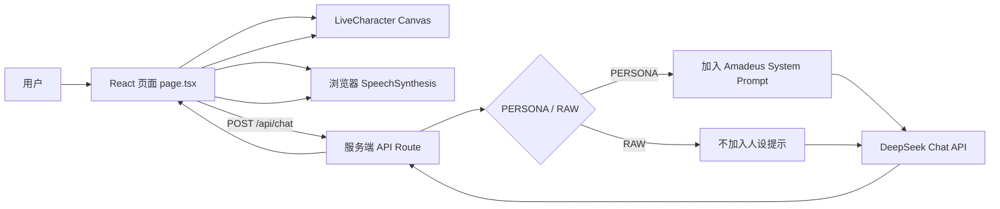
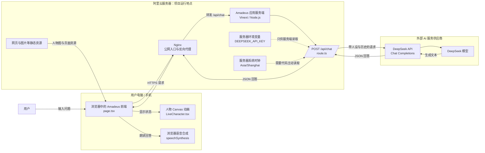

# Amadeus 项目学习报告

> 报告用途：个人学习、理解项目结构与后续开发方向  
> 分析日期：2026-08-08  
> 网页源码目录：`D:\Amadeus`  
> Live2D 素材加工目录：`C:\Users\lenovo\Documents\Amadeus`

---

## 1. 项目结论摘要

Amadeus 是一个带有角色形象、语音朗读和特定人格的网页 AI 助手。用户在浏览器中输入问题，前端把对话发送到同站点的 `/api/chat`，服务端读取本地环境变量中的 DeepSeek API Key，再向 DeepSeek 请求回答。这样做的关键价值是：API Key 留在服务端，不会暴露给浏览器。

项目目前可以分成两个相互关联但尚未完全接通的子系统：

1. **网页智能助手**：已经实现对话、人设、原始回答模式、浏览器语音、响应式界面和基于图片图集的伪动态角色。
2. **Live2D 素材生产管线**：已经产出可导入 Cubism 的分层 PSD，并建立了 81 个部件定义、参数清单和质量检查流程，但还没有生成 `.moc3`、`.model3.json` 等真正的 Live2D 运行文件，也没有接入网页。

因此，当前网页里的人物虽然会呼吸、眨眼、说话和跟随鼠标，但它本质上仍然是 **Canvas 对多张静态图进行切片、变形和叠加**，不是 Live2D Cubism 模型。当前项目最重要的下一阶段，是在 Cubism Editor 中完成网格、参数、物理和导出，然后把 `LiveCharacter.tsx` 替换成 Cubism Web 渲染器。

---

## 2. 项目目标与当前完成度

| 目标 | 当前状态 | 说明 |
|---|---:|---|
| 网页输入问题 | 已完成 | React 受控文本框，Enter 发送，Shift+Enter 换行 |
| 调用 DeepSeek API | 已完成 | 服务端 `/api/chat` 代理请求，Key 不下发浏览器 |
| Amadeus / 牧濑红莉栖风格人设 | 已完成 | 通过服务端 system prompt 控制 |
| 原始回答模式 | 已完成 | 输入 `EL PSY KONGROO` 在 PERSONA/RAW 间切换 |
| 对话历史 | 部分完成 | 仅保存在当前浏览器内存，刷新页面即丢失 |
| 语音朗读 | 已完成 | 使用浏览器 `speechSynthesis`，不是云端 TTS |
| 人物眨眼、呼吸、嘴部动画 | 已完成 | Canvas + 精灵图实现 |
| 真正 Live2D 连贯变形 | 尚未完成 | 已有导入 PSD，但尚未完成 Cubism 建模和网页 SDK 接入 |
| 本地部署 | 已完成 | Vinext 开发服务器，可通过脚本后台启动 |
| 阿里云部署 | 基本完成 | Node/Vinext + PM2 + Nginx；大陆域名访问还受 ICP 备案约束 |
| HTTPS | 尚未完成 | 需要备案后申请证书并配置 Nginx 443 |
| 公网防滥用 | 尚未完成 | 无登录、无速率限制，API 费用存在风险 |

---

## 3. 两个项目目录分别是什么

### 3.1 网页主项目：`D:\Amadeus`

这是可以安装依赖、运行、构建和部署的完整 Web 项目。

```text
D:\Amadeus
├─ app
│  ├─ page.tsx                 # 主页面、聊天状态和发送逻辑
│  ├─ LiveCharacter.tsx        # Canvas 人物动画
│  ├─ globals.css              # 整体界面与响应式样式
│  ├─ layout.tsx               # HTML 布局与网页元数据
│  └─ api/chat/route.ts        # DeepSeek 服务端接口、人设逻辑
├─ public
│  ├─ kurisu-sprite-v1.png     # 1536×1024、每格 512×512 的表情图集
│  └─ amadeus-assistant.png    # 角色静态素材
├─ scripts/local-server.mjs    # 本地后台启动、停止和状态检测
├─ scripts/photoshop           # 较早期的 PSD 自动化脚本
├─ live2d-assets-v1            # Live2D 图层、参数和质量模板
├─ worker/index.ts             # Cloudflare/Vinext Worker 入口
├─ tests                       # 构建产物的基础测试
├─ package.json                # 依赖和 npm 命令
└─ vite.config.ts              # Vinext、Vite、Cloudflare/Sites 配置
```

### 3.2 Live2D 加工目录：`C:\Users\lenovo\Documents\Amadeus`

这里不是完整网站，而是最近的 Photoshop 自动化、对齐诊断和导出预览目录。

当前共包含 21 个 JSX 脚本，约 3142 行代码；主要产物包括：

- `Amadeus_import_v3_preview.png`：Cubism 导入 PSD 的合成预览。
- `diagnostics/groups/`：8 个主要部件组的单独预览。
- `diagnostics/layers/`：后发、后衣等重点图层的诊断图。
- `amadeus_trace_batch_01.jsx`：当前最核心的 81 部件自动拆分脚本。
- `export_amadeus_cubism_import_psd_v3.jsx`：生成 Cubism 导入 PSD。
- `verify_amadeus_cubism_import_v3.jsx`：检查导入 PSD 并输出预览。

当前 Cubism 导入预览如下：


---

## 4. 技术栈

| 技术 | 版本/形式 | 在项目中的用途 |
|---|---|---|
| TypeScript | 5.9.3 | 前后端主要开发语言 |
| React | 19.2.6 | 页面组件、状态管理和交互 |
| Next.js | 16.2.6 | App Router、服务端 API 路由和元数据 |
| Vinext | 0.0.50 | 用 Vite 构建并运行 Next 风格应用 |
| Vite | 8.0.13 | 开发服务器和打包器 |
| Tailwind CSS | 4.2.1 | 被引入，但当前界面主要使用手写 CSS |
| Canvas 2D | 浏览器原生 | 绘制、切片、扭曲和叠加人物图像 |
| Web Speech API | 浏览器原生 | 中文回答的语音朗读 |
| DeepSeek Chat API | HTTP 接口 | 生成最终对话回答 |
| Photoshop JSX | ExtendScript | 自动创建、拆分、检查和导出 PSD |
| Live2D Cubism | 待接入 | 未来真正的参数化角色动画 |
| PM2 + Nginx | 阿里云部署 | Node 进程守护与反向代理 |

`package.json` 要求 Node.js `>=22.13.0`。主要命令为：

```bash
npm run dev          # 前台开发服务器
npm run local        # 后台启动本地开发服务器
npm run local:status # 查看本地服务状态
npm run local:stop   # 停止后台服务
npm run build        # 构建
npm run start        # 运行生产构建
npm test             # 构建后执行基础测试
```

---

## 5. 总体架构



这个结构是一种典型的 **前端界面 + 同源服务端代理 + 第三方大模型** 架构。

最重要的安全边界位于 `/api/chat`：浏览器只知道自己要请求 `/api/chat`，真正的 `DEEPSEEK_API_KEY` 由服务端从 `.env.local` 读取。只要不把 `.env.local` 上传到公开仓库或放进 `public/`，Key 就不会直接暴露给访问者。

---

## 6. 一次完整对话是怎样发生的

### 第一步：用户输入

`app/page.tsx` 使用 `input` 保存文本框内容。用户按 Enter 或点击 SEND 后执行 `sendMessage()`。如果按 Shift+Enter，则保留换行。

### 第二步：前端更新状态

发送前，前端会：

1. 去除输入首尾空格。
2. 把用户消息追加到 `messages`。
3. 把 `thinking` 设置为 `true`。
4. 清空输入框。
5. 停止正在播放的旧语音。

此时角色状态变为 `processing`，界面显示 `ANALYZING INPUT`，人物切换到思考姿态。

### 第三步：请求服务端

前端发送：

```json
{
  "messages": [
    { "role": "user", "content": "用户的问题" }
  ],
  "rawMode": false
}
```

请求地址是同源的 `/api/chat`，所以本地、阿里云和其他部署环境可以沿用同一段前端代码。

### 第四步：服务端整理上下文

`app/api/chat/route.ts` 会执行以下限制：

- 只接受 `user` 和 `assistant` 两类消息。
- 只保留最后 20 条消息。
- 每条消息最多截取 8000 个字符。
- 如果没有任何用户消息，返回 HTTP 400。
- 检查口令并决定是否加入人设 prompt。

### 第五步：调用 DeepSeek

服务端向以下地址发起 POST：

```text
https://api.deepseek.com/chat/completions
```

模型名来自 `DEEPSEEK_MODEL`；未配置时使用代码中的默认值 `deepseek-v4-flash`。API Key 通过 `Authorization: Bearer ...` 放在请求头中。

### 第六步：显示并朗读回答

回答返回后，前端把文本加入 `messages`，随后调用浏览器 `speechSynthesis` 朗读。语音开始时 `speaking=true`，人物进入说话动画；结束或报错后恢复 `ready`。

---

## 7. 前端状态管理

页面没有引入 Redux、Zustand 等状态库，而是使用 React 自带的 `useState` 和 `useRef`。

| 状态 | 类型 | 用途 |
|---|---|---|
| `messages` | 消息数组 | 保存当前会话内容 |
| `input` | 字符串 | 文本框内容 |
| `thinking` | 布尔值 | 是否等待接口回答 |
| `speaking` | 布尔值 | 浏览器是否正在朗读 |
| `rawMode` | 布尔值 | 是否关闭 Amadeus 人设 |
| `voiceOn` | 布尔值 | 是否启用朗读 |

页面根据两个状态推导角色模式：

```text
thinking = true  → processing
否则 speaking = true → speaking
否则 → ready
```

这种设计很适合当前规模，优点是简单、直观。缺点是刷新页面后所有状态都会消失；如果以后加入会话列表、登录、云端历史记录，应该把会话状态拆到独立 hook 或状态管理模块中。

---

## 8. Amadeus 人设与口令切换

### 8.1 人设模式

服务端的 `PERSONA_PROMPT` 定义了角色的知识气质和语言规则，核心包括：

- 科研、脑科学和物理学背景。
- 重视证据、定义、逻辑和可验证性。
- 外冷内热、好胜、会反驳错误但不攻击用户本人。
- 默认使用自然短段落，而不是客服式列表。
- 严肃求助时收起吐槽。
- 不主动提及 DeepSeek、API、系统提示或底层模型。

人设放在服务端而不是前端，有两个好处：一是普通用户不会在页面源码里直接看到完整提示；二是调用模型时可以保证 system message 位于对话最前面。

### 8.2 RAW 模式

口令为：

```text
EL PSY KONGROO
```

前端识别口令后翻转 `rawMode`，服务端也会重新统计历史口令次数，形成双重判断：

```text
第一次输入 → RAW 模式
第二次输入 → PERSONA 模式
第三次输入 → RAW 模式
……
```

服务端会从最后一次口令之后截取新的活动对话，因此切换模式后，旧模式的上下文不会继续污染新模式。

### 8.3 当前设计问题

`rawMode` 同时由客户端传入，外部调用者可以绕过口令，直接发送 `rawMode: true`。这不属于 API Key 泄露，但说明模式权限完全由客户端控制。如果 RAW 模式只是彩蛋，这个问题不严重；如果以后不同模式涉及付费、权限或安全策略，就必须只由服务端会话状态决定。

---

## 9. 当前人物动画原理

### 9.1 精灵图结构

`public/kurisu-sprite-v1.png` 的尺寸是 1536×1024，由 3 列、2 行、每格 512×512 的表情图组成。

`LiveCharacter.tsx` 当前使用其中五种帧：

| 帧 | 坐标 | 用途 |
|---|---:|---|
| `neutral` | (0, 0) | 默认表情 |
| `blink` | (1, 0) | 闭眼区域 |
| `mouthSmall` | (2, 0) | 小口型 |
| `mouthWide` | (0, 1) | 大口型 |
| `thinking` | (1, 1) | 思考姿态 |

### 9.2 身体伪变形

组件把一张 512×512 的人物帧横向切成 28 条。绘制每条时施加不同的水平位移、宽度变化和垂直抬升，于是整张图片看起来会弯曲、呼吸和跟随鼠标。

核心思想可以简化为：

```text
源图片 → 切成 28 条 → 每条计算不同偏移 → 逐条重新绘制
```

### 9.3 头部、眨眼和嘴部

代码随后又从图集中裁出头部、眼部和嘴部小区域，叠加到已经变形的身体上：

- 头部根据鼠标位置轻微旋转和移动。
- 每隔约 3.2～6 秒触发一次 0.2 秒眨眼。
- 说话时用两个正弦波生成开口幅度。
- 小口和大口根据幅度进行透明度混合。

嘴部并没有分析真实音频振幅或音素，只要浏览器处于“正在朗读”状态，就按数学波形开合。因此这是“说话状态动画”，不是精确 Lip Sync。

### 9.4 为什么它不是 Live2D

真正的 Live2D Cubism 具有 ArtMesh、Deformer、参数、关键形状、物理系统和模型文件。当前实现只有 Canvas 图片切片，没有：

- `ParamAngleX/Y/Z` 等模型参数。
- 顶点网格和变形器。
- 头发、领带、外套的物理计算。
- `.moc3` 与 `.model3.json`。
- Cubism Web SDK/WebGL 模型渲染。

这也解释了图片叠加边缘、局部错位和动作质感不够自然的问题：被裁出的头部和嘴部必须与底图精确重合，只要坐标、缩放或变形略有差异，就会出现接缝。

---

## 10. Live2D 素材制作管线

### 10.1 当前素材阶段

项目已经从早期的“单张图 + 图层模板”推进到“精细工作 PSB + Cubism 导入 PSD”。当前磁盘上的主要文件为：

| 文件 | 大小约 | 用途 |
|---|---:|---|
| `Amadeus_precision_work_v1.psd` | 876 MB | 第一版精细工作文件 |
| `Amadeus_precision_work_v2.psb` | 2.87 GB | 加入隐藏补画源后的大文档 |
| `Amadeus_precision_work_v3.psb` | 3.75 GB | 当前主要可编辑工作文件 |
| `Amadeus_import_v3.psd` | 124 MB | 清理后供 Cubism 导入的文件 |

工作文件位于：

```text
D:\Amadeus\live2d-psd
```

### 10.2 81 个部件如何产生

`amadeus_trace_batch_01.jsx` 内部定义了 81 个部件。每个部件包含：

- 唯一图层名。
- 目标图层组。
- 一个或多个多边形坐标区域。
- 可选的替代源图片。
- 可选的位置修正。

坐标以批准参考图 1023×1537 为基准，然后映射到 4096×6144 的工作文档：

```text
工作坐标 X = 源图左边界 + 参考 X / 1023 × 源图宽度
工作坐标 Y = 源图上边界 + 参考 Y / 1537 × 源图高度
```

每个部件的实际生成步骤是：

1. 找到共享智能对象源图。
2. 复制智能对象。
3. 把复制层移动到指定图层组。
4. 根据多边形坐标创建选区。
5. 把选区转换为“显示选区”的图层蒙版。
6. 保存工作 PSB。

如果同名部件已经存在，脚本会跳过，从而具备一定的幂等性。如果中途发生异常，脚本会尝试删除本轮已创建的图层。

### 10.3 图层分组

当前主要分组为：

```text
90_EFFECTS_OPTIONAL
80_FRONT_HAIR
70_FRONT_CLOTHES_AND_ARMS
60_FACE_DETAILS
50_FACE_BASE
40_BODY_BASE
30_BACK_CLOTHES
20_BACK_HAIR
00_SOURCE_DO_NOT_IMPORT
```

其中 `00_SOURCE_DO_NOT_IMPORT` 保存原始母版、补画底图、闭眼图和张嘴图，只供制作时使用，导出 Cubism PSD 时会被删除。

面部细节组的诊断预览如下。白色区域表示该组没有绘制内容，而不是模型缺失：


### 10.4 隐藏区域补画

单张正面图没有刘海后面的额头、完整眼球、张嘴口腔、衣服下面的身体和后脑发片。项目通过以下辅助源解决：

- `SOURCE_HIDDEN_BASE_V2`
- `SOURCE_EYE_WHITES_V1`
- `SOURCE_CLOSED_EYES_V1`
- `SOURCE_OPEN_MOUTH_V1`
- `SOURCE_BLANK_FACE_V4_ALIGNED_V2`

这些源图先被缩放到工作文档并放入隐藏源组，再按照多边形选区生成相应部件。

### 10.5 导出 Cubism PSD

`export_amadeus_cubism_import_psd_v3.jsx` 不直接破坏工作 PSB，而是复制文档后执行：

1. 删除 `00_SOURCE_DO_NOT_IMPORT`。
2. 删除校准图层。
3. 栅格化智能对象。
4. 应用图层蒙版。
5. 删除空图层。
6. 设置默认可见性。
7. 保存为带图层的 `Amadeus_import_v3.psd`。

这符合 Live2D Cubism 导入 PSD 的基本要求：每个部件应成为普通像素图层，不能依赖 Photoshop 智能对象和实时蒙版。

### 10.6 仍未完成的步骤

PSD 只是 Live2D 建模的输入，不是运行模型。还需要在 Cubism Editor 中完成：

1. 为每个图层生成并整理 ArtMesh。
2. 建立旋转变形器和曲面变形器。
3. 制作 `ParamAngleX/Y/Z`、眼睛、眉毛、嘴、身体和呼吸参数。
4. 设置眨眼组和 LipSync 组。
5. 制作头发、领带和外套物理。
6. 导出 `.moc3`、`.model3.json`、纹理和 `.physics3.json`。
7. 把模型文件放入 `public/live2d/amadeus/`。
8. 用 Cubism Web SDK 重写 `LiveCharacter.tsx`。

---

## 11. 本地运行机制

### 11.1 环境变量

`.env.local` 应包含：

```dotenv
DEEPSEEK_API_KEY=你的真实Key
DEEPSEEK_MODEL=deepseek-v4-flash
```

不要把真实 Key 写入报告、截图、Git 仓库或前端代码。

### 11.2 普通开发方式

```bash
cd /d D:\Amadeus
npm install
npm run dev
```

### 11.3 后台本地启动脚本

`scripts/local-server.mjs` 封装了一个适合 Windows 的后台开发服务：

- 把 Vinext 作为隐藏后台进程启动。
- PID 写入 `.local-server.pid`。
- 标准输出和错误分别写入日志。
- 每 500 毫秒探测一次 `http://127.0.0.1:3000/`。
- 30 秒内未就绪则停止子进程并显示日志尾部。

这个脚本改善了“命令窗口必须一直开着”的体验，但它仍启动的是开发模式，不应该替代服务器上的正式生产进程。

---

## 12. 云端部署结构

当前阿里云方案可以抽象为：

```mermaid
flowchart LR
    B[朋友的浏览器] -->|HTTP/HTTPS| N[Nginx :80/:443]
    N -->|反向代理| P[Vinext :3000]
    P --> A[/api/chat]
    A --> D[DeepSeek API]
    M[PM2] --> P
```

各组件职责：

- **PM2**：保证 Node/Vinext 进程退出后可以重启。
- **Nginx**：监听公网 80/443，反向代理到本机 127.0.0.1:3000。
- **阿里云安全组**：只对公网开放 80、443，并限制 22 的来源。
- **DNS**：`ljq2333.fun` 和 `www.ljq2333.fun` 指向 ECS 公网 IP。
- **ICP 备案**：大陆 ECS 对外使用域名的前置要求。
- **SSL 证书**：备案后配置 HTTPS 和 HTTP→HTTPS 跳转。

应用端口 3000 只需要监听 `127.0.0.1`，不应直接对公网开放。

---

## 13. 当前测试覆盖

`tests/rendered-html.test.mjs` 目前只有两类测试：

1. 首页可以返回 200，包含指定标题和界面文字。
2. 未配置 DeepSeek Key 时，接口返回 `demo: true` 和非空文本。

已有日志显示首页和 `/api/chat` 多次成功返回 200，真实对话常见耗时约 1～10 秒。日志还出现过：

```text
Detected multiple renderers concurrently rendering the same context provider.
```

该警告暂时没有阻断页面，但说明 Vinext/React 开发环境中可能存在并行渲染器上下文问题，升级相关依赖时应重新验证。

建议补充以下测试：

- PERSONA/RAW 口令往返切换。
- 最后一次口令之前的历史被正确丢弃。
- 非法 JSON、空消息、超长消息和错误角色。
- DeepSeek 超时、401、429、500 和无 `choices` 返回。
- 前端发送失败后的状态恢复。
- `ready / processing / speaking` 三种人物状态。
- 手机端布局和 `prefers-reduced-motion`。

---

## 14. 主要优点

### 14.1 前后端边界正确

API Key 保留在服务端，前端只访问同源 API，这是接入第三方大模型时最重要的基础设计。

### 14.2 状态与视觉反馈统一

`thinking` 和 `speaking` 不仅控制文字，也控制角色状态、状态标签和语音，用户容易理解系统正在做什么。

### 14.3 人设规则较具体

提示词不只是罗列性格标签，还规定了段落长度、澄清问题数量、严肃场景行为和禁止客服腔，使模型更容易产生稳定风格。

### 14.4 Live2D 制作流程有工程意识

工作 PSB 与导入 PSD 分开，源图隐藏、部件命名、默认可见性、导出清理和验证脚本都有明确职责，降低了手工重复操作。

### 14.5 有基础的可访问性和响应式处理

消息区域使用 `aria-live`，Canvas 有文本替代，CSS 兼容手机布局，并针对 `prefers-reduced-motion` 关闭动画。

---

## 15. 风险与改进建议

| 优先级 | 问题 | 影响 | 建议 |
|---:|---|---|---|
| P0 | 公网接口无速率限制 | 任何人可消耗 DeepSeek 额度 | 按 IP/会话限流，设置每日额度和请求并发上限 |
| P0 | 当前网页人物不是真 Live2D | 动作上限低，容易出现叠加接缝 | 完成 Cubism 建模并接入 Web SDK |
| P1 | DeepSeek 请求无超时 | 上游卡住时用户会长期等待 | 使用 `AbortSignal.timeout()`，统一超时提示 |
| P1 | 非流式回答 | 长回答要等待全部生成后才显示 | 改用流式接口和逐字/逐块渲染 |
| P1 | 上下文上限按字符而非 token | 最坏可发送约 16 万字符 | 按 token/总字符限制，必要时摘要旧消息 |
| P1 | `rawMode` 信任客户端 | 可以不输入口令直接启用 RAW | 在服务端用签名 Cookie 或会话保存模式 |
| P1 | 会话只存在内存 | 刷新即丢失 | 先用 LocalStorage，再按需要加入数据库 |
| P1 | Git 工作区未整理 | 关键修改和素材未提交，恢复困难 | 分离网页仓库与大素材目录，立即建立版本快照 |
| P1 | Photoshop 脚本硬编码绝对路径 | 换电脑或盘符后全部失效 | 抽出统一配置文件或运行时选择目录 |
| P1 | 脚本版本命名漂移 | `batch_01` 已含 81 部件，`all63` 名称过时 | 建立单一 manifest，自动生成脚本和文件名 |
| P1 | 个别中文图层名发生乱码 | 导出时可能无法删除目标图层 | 全部改为稳定英文名，统一 UTF-8 代码文件 |
| P2 | 未渲染 Markdown | 模型返回的 Markdown 只作为纯文本展示 | 采用安全的 Markdown 渲染器并过滤 HTML |
| P2 | 浏览器 TTS 音色不稳定 | 不同设备声音不同，嘴型无法精确同步 | 后续接入可控 TTS 与音频幅度/音素驱动 |
| P2 | D1、Drizzle、ChatGPT Auth 为未使用模板代码 | 增加理解和维护负担 | 未计划使用时删除，或移动到 examples |

### 15.1 版本控制风险特别说明

`D:\Amadeus` 的最近一次提交是 2026-07-30 的 `Deploy Amadeus assistant`，但当前人设、页面、脚本和 Live2D 素材存在大量未提交修改。PSD 文件最大约 3.75 GB，不适合直接提交到普通 Git。

建议：

1. 网页源码使用 Git 管理。
2. PSD/PSB、纹理和生成素材放到独立素材目录或对象存储。
3. Git 只保存清单、参数 CSV、缩略图和自动化脚本。
4. 每次重大拆件前复制一个只读备份。

---

## 16. 推荐重构路线

### 阶段一：建立可靠基线

- 整理 `D:\Amadeus` Git 状态并提交网页源码。
- 将大体积 PSD 从代码仓库排除。
- 把人设 prompt、模式配置和模型参数拆到独立模块。
- 删除或隔离未使用的 D1/Auth 模板代码。

### 阶段二：加固聊天服务

- 给 DeepSeek 请求增加 30～60 秒超时。
- 加入 IP 限流、请求大小限制和每日预算。
- 规范化错误码，不直接透传过多供应商错误。
- 增加流式输出。
- 为模式切换和错误场景增加单元测试。

### 阶段三：完成 Cubism 模型

- 先做最小可用参数：双眼开合、嘴开合、头部 XY、身体 X、呼吸。
- 再做眼球、眉毛、嘴型、头部 Z。
- 最后加入头发、领带、外套物理和表情。
- 在 Viewer 中先确认模型稳定，再进入网页集成。

### 阶段四：接入真正 Live2D

- 将 Cubism 导出文件放入 `public/live2d/amadeus/`。
- 使用 Cubism SDK for Web 或兼容运行库加载 `amadeus.model3.json`。
- 把页面状态映射为模型参数和动作：

```text
ready      → idle 动作 + 自动眨眼 + 呼吸
processing → thinking 动作 + 视线偏移
speaking   → LipSync + 轻微身体摆动
```

- 删除旧的头部和嘴部图片补丁逻辑，彻底消除叠加接缝。

### 阶段五：正式公网发布

- 完成 ICP 备案。
- 配置 HTTPS。
- 只开放 80/443，限制 SSH。
- 配置日志轮转、PM2 开机启动和健康检查。
- 在页面底部展示备案号和必要的版权/非官方声明。

---

## 17. 个人学习路线

### 模块一：先读懂 React 页面

重点阅读：

```text
D:\Amadeus\app\page.tsx
```

学习目标：

- `useState` 如何保存界面状态。
- 受控文本框如何工作。
- 表单提交和键盘事件的区别。
- 异步 `fetch` 的 `try/catch/finally` 为什么重要。
- 状态如何驱动 CSS 类名和子组件属性。

练习：增加“清空输入”按钮，或把语音开关状态保存到 LocalStorage。

### 模块二：读懂服务端 API

重点阅读：

```text
D:\Amadeus\app\api\chat\route.ts
```

学习目标：

- HTTP POST、JSON、状态码和请求头。
- 环境变量与服务端秘密。
- system/user/assistant 三类消息。
- 数据校验和错误处理。
- 为什么不能从浏览器直接调用带私人 Key 的模型 API。

练习：给 DeepSeek 请求添加 45 秒超时，并为超时返回 504。

### 模块三：理解 Canvas 动画

重点阅读：

```text
D:\Amadeus\app\LiveCharacter.tsx
```

学习目标：

- `requestAnimationFrame` 渲染循环。
- delta time 与帧率无关动画。
- 线性插值 `lerp`。
- 精灵图裁切和 `drawImage` 参数。
- 鼠标坐标归一化、平滑跟随和透明度混合。

练习：在不改变图集的前提下，增加“向左看/向右看”的调试滑块。

### 模块四：理解 Live2D 资产管线

重点阅读：

```text
C:\Users\lenovo\Documents\Amadeus\amadeus_trace_batch_01.jsx
C:\Users\lenovo\Documents\Amadeus\export_amadeus_cubism_import_psd_v3.jsx
D:\Amadeus\live2d-assets-v1\templates\Amadeus_parameters.csv
```

学习目标：

- 原图、工作 PSD、导入 PSD 和运行模型之间的区别。
- 为什么被遮挡区域必须补画。
- ArtMesh、Deformer、Parameter 和 Physics 的职责。
- 为什么导入 PSD 不能保留智能对象和未应用蒙版。

练习：先只用脸、眼睛和嘴制作一个最小模型，不要一开始就绑定所有 81 个部件。

### 模块五：学习部署

学习目标：

- 开发服务器与生产服务器的区别。
- PM2 为什么是进程管理器，Nginx 为什么是反向代理。
- DNS、端口、安全组、备案和 SSL 各自属于哪一层。
- 为什么 `127.0.0.1:3000` 不应该直接暴露给公网。

---

## 18. 关键术语

| 术语 | 简明解释 |
|---|---|
| App Router | Next.js 按 `app/` 目录组织页面和 API 的方式 |
| API Route | 运行在服务端、供浏览器请求的接口函数 |
| System Prompt | 给模型规定身份、风格和行为的最高层上下文 |
| 同源请求 | 页面和 API 使用同一个域名，前端请求 `/api/chat` |
| Sprite Atlas | 把多张表情帧放进一张大图 |
| Canvas | 浏览器里的即时绘图区域 |
| Lip Sync | 根据语音驱动嘴部开合或音素口型 |
| ArtMesh | Live2D 中可变形的绘制网格 |
| Deformer | 控制多个网格一起变形的变形器 |
| Parameter | 头部角度、眼睛开合、嘴开合等可驱动数值 |
| Physics | 头发、衣服、领带等延迟和弹性的模拟 |
| PSD/PSB | Photoshop 文档；PSB 用于超大文件 |
| `.moc3` | Cubism 导出的模型核心数据 |
| `.model3.json` | Web 运行时加载模型的入口清单 |
| PM2 | Node.js 进程守护与重启工具 |
| Nginx | Web 服务器和反向代理 |

---

## 19. 重点源码索引

| 想理解的内容 | 文件 |
|---|---|
| 页面布局与聊天状态 | `D:\Amadeus\app\page.tsx` |
| Canvas 人物动画 | `D:\Amadeus\app\LiveCharacter.tsx` |
| 人设与 DeepSeek API | `D:\Amadeus\app\api\chat\route.ts` |
| 黑金终端界面样式 | `D:\Amadeus\app\globals.css` |
| 本地后台启动 | `D:\Amadeus\scripts\local-server.mjs` |
| 构建与 Worker 配置 | `D:\Amadeus\vite.config.ts`、`worker\index.ts` |
| 基础自动测试 | `D:\Amadeus\tests\rendered-html.test.mjs` |
| Live2D 参数设计 | `D:\Amadeus\live2d-assets-v1\templates\Amadeus_parameters.csv` |
| 81 部件自动拆分 | `C:\Users\lenovo\Documents\Amadeus\amadeus_trace_batch_01.jsx` |
| Cubism PSD 导出 | `C:\Users\lenovo\Documents\Amadeus\export_amadeus_cubism_import_psd_v3.jsx` |
| 导出结果检查 | `C:\Users\lenovo\Documents\Amadeus\verify_amadeus_cubism_import_v3.jsx` |

---

## 20. 最终理解

这个项目不是单纯的“调用一次 API”。它已经包含一个小型完整产品所需的多个层次：界面、状态管理、服务端代理、人格提示、语音、动画、素材制作、构建和部署。

理解它时应始终分清三条链路：

1. **对话链路**：输入 → `/api/chat` → DeepSeek → 回答。
2. **表现链路**：`thinking/speaking` → Canvas 状态 → 语音和人物动画。
3. **Live2D 生产链路**：原画 → 分层 PSB → Cubism 导入 PSD → Cubism 参数/物理 → Web 模型。

目前第一条链路已经可用，第二条链路是图片动画版，第三条链路已经完成高质量的 PSD 准备但尚未走完 Cubism 和网页接入。后续开发不应继续在旧精灵图上堆叠更多局部图片补丁，而应把主要精力放在完成真正的 Cubism 模型、API 防滥用和正式部署合规上。

---

## 21. 完整项目结构与各文件作用

这一节按“真实运行时是否会用到”解释文件。项目中既有当前网站必需的文件，也有早期模板、部署产物和 Live2D 制作素材。学习时不要把它们混为一谈。

### 21.1 根目录结构

```text
D:\Amadeus
├─ app/                    当前网站的页面、组件和 API
├─ public/                 浏览器可以直接访问的静态文件
├─ scripts/                本地启动与 Photoshop 自动化脚本
├─ tests/                  自动测试
├─ worker/                 Vinext 的 Cloudflare Worker 入口
├─ build/                  Sites/Vite 构建辅助插件
├─ db/                     尚未投入使用的数据库模板
├─ examples/               示例代码，不属于当前业务主链路
├─ drizzle/                Drizzle 迁移元数据
├─ live2d-assets-v1/       Live2D 第一版素材包与制作规范
├─ live2d-psd/             大体积 PSD/PSB 工作文件和导入文件
├─ design-reference/       批准的角色造型参考
├─ dist/                   构建输出，可重新生成
├─ node_modules/           npm 依赖，可重新安装
├─ .openai/                Sites 托管配置
├─ .wrangler/              Cloudflare 本地工具状态
├─ package.json            项目依赖与命令
├─ package-lock.json       锁定依赖的精确版本
├─ vite.config.ts          Vite/Vinext/Cloudflare 构建配置
├─ next.config.ts          Next 配置，目前基本为空
├─ tsconfig.json           TypeScript 编译检查配置
├─ eslint.config.mjs       代码规范检查配置
├─ postcss.config.mjs      Tailwind/PostCSS 配置
├─ drizzle.config.ts       Drizzle 数据库工具配置
├─ .env.example            环境变量示例
├─ .env.local              本机秘密配置，不应上传或公开
└─ README.md               简要运行说明
```

### 21.2 `app/`：当前网站的核心代码

#### `app/page.tsx`

这是主页面和前端控制中心，职责最多：

- 声明 `Message` 消息类型。
- 保存欢迎语和三个快捷问题。
- 管理消息、输入框、思考、朗读、RAW 模式和语音开关。
- 判断 `EL PSY KONGROO` 口令并翻转模式。
- 调用 `/api/chat`。
- 用浏览器 `SpeechSynthesisUtterance` 朗读回答。
- 根据状态计算 `ready / processing / speaking`。
- 渲染顶部状态栏、左侧人物、右侧消息和底部输入框。

它同时承担了 UI、业务状态、网络请求和语音控制，当前规模还能工作，但继续扩展时应该拆分。

建议未来拆成：

```text
hooks/useChat.ts             对话状态与请求
hooks/useSpeech.ts           语音朗读
lib/mode-command.ts          口令判断
components/SystemBar.tsx     顶部状态栏
components/ChatPanel.tsx     消息列表与输入区
components/PortraitPanel.tsx 人物区域
```

#### `app/LiveCharacter.tsx`

这是当前人物动画组件，不是真正的 Live2D。它负责：

- 加载 `/kurisu-sprite-v1.png`。
- 从 3×2 精灵图中选择默认、闭眼、口型和思考帧。
- 用 Canvas 横向切片模拟身体弯曲与呼吸。
- 用鼠标坐标驱动头部和身体轻微跟随。
- 随机触发眨眼。
- 在 `speaking` 状态下用数学波形驱动嘴部。
- 响应 Canvas 尺寸变化并适配高 DPI 屏幕。
- 在卸载时取消动画帧并断开 `ResizeObserver`。

将来接入 Cubism 后，这个组件仍可以保留相同的 `mode` 接口，但内部应改为加载 `.model3.json` 并设置模型参数。

#### `app/api/chat/route.ts`

这是浏览器与 DeepSeek 之间的服务端代理，也是人设逻辑所在地。它负责：

- 校验请求 JSON。
- 过滤非法消息角色。
- 保留最后 20 条消息。
- 限制每条消息为 8000 字符。
- 判断 PERSONA/RAW 模式。
- 处理口令并返回本地模式提示。
- PERSONA 模式下注入 `PERSONA_PROMPT`。
- 从服务器环境读取 API Key 和模型名。
- 请求 DeepSeek Chat Completions API。
- 把供应商响应转换成统一 JSON 返回前端。
- 处理无 Key、上游错误和异常请求。

这是最需要加强测试、日志、超时和限流的文件。

#### `app/globals.css`

这是当前界面的主要视觉实现，约 915 行。虽然项目引入了 Tailwind，但本页面主要使用普通 CSS 类。内容包括：

- 黑、金、琥珀色主题变量。
- 顶部终端状态栏。
- 左右双栏工作区。
- 人物舞台、扫描线、屏幕纹理和聚焦框。
- 消息气泡、思考点动画和输入框。
- 900px 与 560px 两级响应式布局。
- `prefers-reduced-motion` 无障碍降动画设置。

目前文件较长，可以按页面区域拆成 CSS Module，或者保留一个小型全局主题文件，再由各组件管理自己的样式。

#### `app/layout.tsx`

定义整个应用共享的 HTML 外壳：

- 设置网页标题和描述。
- 设置 favicon。
- 将语言标记为 `zh-CN`。
- 引入 `globals.css`。

其中描述仍写着“由 DeepSeek 驱动”，而人设要求不主动提及底层供应商。网页元数据不属于角色回答，但若想保持产品包装一致，可以改为更中性的描述。

#### `app/chatgpt-auth.ts`

这是 Sites/ChatGPT 托管模板提供的认证辅助代码，能读取托管环境注入的用户请求头并构造登录、退出路径。当前主页和 `/api/chat` 都没有导入它，因此 **当前本地网站与阿里云网站不依赖登录**。

如果确定只做无需登录的公开网站，可以把该文件移动到 `examples/` 或删除；若未来要限制朋友使用，可以改用自己的简单访问令牌或完整账号系统，不能指望阿里云自动提供这些 ChatGPT 专用请求头。

### 21.3 `public/`：浏览器静态资源

#### `public/kurisu-sprite-v1.png`

1536×1024 的人物表情图集，每个单元格为 512×512。当前 `LiveCharacter.tsx` 直接依赖它；删除或改名会导致人物 Canvas 空白。

#### `public/amadeus-assistant.png`

早期角色静态图片。目前主页面使用 Canvas 精灵图，是否仍在其他页面引用应在删除前通过 `rg` 检查。

#### `public/favicon.svg`

浏览器标签页图标，由 `layout.tsx` 引用。

#### `public/file.svg`、`globe.svg`、`window.svg`

来自项目模板的通用图标，当前主页面没有使用。确认全局搜索无引用后可以删除。

### 21.4 `scripts/`：运行与素材自动化

#### `scripts/local-server.mjs`

Windows 本地后台启动器。它调用项目内的 Vinext CLI，在 `127.0.0.1:3000` 启动开发服务器，并管理 PID 和日志。对应：

```bash
npm run local
npm run local:status
npm run local:stop
```

#### `scripts/photoshop/build_amadeus_live2d_psd.jsx`

早期 PSD 骨架生成脚本。它建立 4096×6144 画布和预期图层组，但不能自动从扁平原画得到可信拆件。

#### `scripts/photoshop/amadeus_precision_psd_panel.jsx`

Photoshop 精细拆件面板。用户在共享智能对象上手动选择部件后，面板可以复制源图并把当前选区做成图层蒙版。

#### `scripts/photoshop/launch_amadeus_precision_psd_cc2018.jsx`

用于启动或辅助打开 Photoshop CC 2018 精细 PSD 工作流程。

#### `scripts/photoshop/README-*.md`

这些是 Photoshop 脚本的操作说明和设计依据，不参与网页运行。

### 21.5 `tests/`：自动验证

#### `tests/rendered-html.test.mjs`

使用 Node 内置测试框架加载构建后的 Worker：

- 检查首页返回 200 和正确的标题、界面文案。
- 检查未配置 API Key 时返回 DEMO 回答。

它是“冒烟测试”，只能证明基本入口没有完全坏掉，不能覆盖真实 DeepSeek、多轮上下文、口令和 Canvas 动画。

### 21.6 构建与运行配置

#### `package.json`

项目清单，包含名称、Node 版本要求、npm 命令、运行依赖和开发依赖。查看一个陌生 Node 项目时通常应先读这个文件。

#### `package-lock.json`

记录所有直接与间接依赖的精确版本和完整依赖树。应提交 Git，不应手工编辑。

#### `vite.config.ts`

组合 Vinext、Sites 和 Cloudflare Vite 插件；为 D1/R2 准备本地绑定，并让 Wrangler 状态保存在项目目录。阿里云自托管并不需要所有 Cloudflare 配置，但当前构建链仍会读取此文件及 `.openai/hosting.json`。

#### `next.config.ts`

Next 配置，目前没有实际选项。它曾在服务器部署时被误认为需要 `standalone` 输出，但当前运行方式是 `vinext start`，不会生成传统 Next 的 `dist/standalone/server.js`。

#### `tsconfig.json`

启用严格 TypeScript 检查、React JSX、Bundler 模块解析、`@/*` 路径别名，并设置 `noEmit`，表示 TypeScript 只负责类型检查，实际构建由 Vite/Vinext 完成。

#### `eslint.config.mjs`

使用 Next Core Web Vitals 和 TypeScript 规则检查代码质量。

#### `postcss.config.mjs`

为 Tailwind CSS 4 配置 PostCSS。即便目前大量样式是手写 CSS，`globals.css` 顶部仍有 `@import "tailwindcss"`，所以构建时会用到。

#### `.env.example`

只提供环境变量名称和示例值，可以提交 Git。

#### `.env.local`

保存真实 DeepSeek API Key。必须位于 `.gitignore` 中，不能发送给别人、上传公开仓库或打进前端静态资源。

### 21.7 Cloudflare/Sites 模板相关文件

#### `worker/index.ts`

Vinext Worker 入口。它处理 `/_vinext/image` 图片优化请求，其余请求交给 Vinext App Router。阿里云使用 `vinext start` 时仍来自同一套构建产物，但 D1、Images 等 Cloudflare 绑定不属于当前 Amadeus 核心功能。

#### `build/sites-vite-plugin.ts`

Sites 构建辅助插件。服务器上曾因上传包缺少此文件而导致 `vite.config.ts` 无法解析，说明它目前属于构建必需文件。

#### `.openai/hosting.json`

Sites 项目 ID 和 D1/R2 配置。当前值未启用 D1/R2，但 `vite.config.ts` 会静态导入它，因此文件缺失会让构建立即失败。

#### `.wrangler/`

Cloudflare/Wrangler 的本地状态与日志，可重新生成，通常不应作为业务源码阅读重点。

### 21.8 数据库相关模板

#### `db/index.ts`

从 Cloudflare Worker 环境读取 D1 绑定并创建 Drizzle 客户端。

#### `db/schema.ts`

目前故意为空，没有任何正式数据表。

#### `drizzle.config.ts` 与 `drizzle/`

Drizzle Kit 的 SQLite/D1 迁移配置和元数据。

#### `examples/d1/`

一个 notes 数据表示例，演示如何使用 D1。当前聊天功能没有导入它，不会保存会话。

这些文件说明项目模板具有数据库扩展能力，但当前网站刷新后丢失聊天记录是正常的，因为数据库链路根本没有接入。

### 21.9 Live2D 第一版素材包

#### `live2d-assets-v1/source/amadeus-live2d-source-v1.png`

用于重新描线、拆件和补画的正面底稿，不是可直接运行的 Live2D 模型。

#### `live2d-assets-v1/reference/kurisu-expression-atlas-original.png`

原精灵图备份，供脸型、发色、服装和表情对照。

#### `live2d-assets-v1/reference/expressions/*.png`

从精灵图裁出的默认、眨眼、思考和口型参考帧。

#### `live2d-assets-v1/templates/Amadeus_Live2D_layer_manifest.csv`

部件清单：名称、是否必需、是否需要补画、主要绑定参数及注意事项。

#### `live2d-assets-v1/templates/Amadeus_parameters.csv`

参数计划，包含头部、身体、眼睛、眉毛、嘴、呼吸、手臂、头发、领带和外套参数的标准 ID 与范围。

#### `live2d-assets-v1/templates/PSD_LAYER_TREE.md`

建议的 PSD 图层树和上下遮挡顺序。

#### `live2d-assets-v1/templates/quality-checklist.md`

导入 PSD 前、Cubism 建模中和网页导出后的检查表。

#### `live2d-assets-v1/export-target/README.md`

规定未来模型应放到 `public/live2d/amadeus/`，并说明 `.model3.json`、`.moc3`、纹理、物理、动作与表情文件的关系。

### 21.10 大体积素材与生成产物

#### `design-reference/approved/Amadeus-classic-approved-v1.png`

批准的造型基准，是精细拆件的坐标与视觉权威来源。

#### `live2d-psd/Amadeus_precision_work_v*.psd/psb`

可编辑工作文件。PSB 用于超过 PSD 文件大小限制的大文档。它们包含共享智能对象、蒙版、补画源和复杂分组，不应直接导入 Cubism。

#### `live2d-psd/Amadeus_import_v3.psd`

经过删除源组、栅格化、应用蒙版和清除空层后得到的 Cubism 导入文件。

#### `dist/`

`npm run build` 生成的客户端和服务端产物，可以删除后重新构建，不应作为主要源码修改。

#### `node_modules/`

`npm install` 生成的依赖目录，可以重新安装，不应上传 WinSCP 或提交 Git。

#### `Amadeus-WinSCP-*.zip`

为服务器传输准备的代码压缩包。它是发布快照，不是唯一源码，修改项目后需要重新生成。

#### `Amadeus-Live2D-assets-v1.zip`

Live2D 第一版素材包归档。

#### `.local-server.*` 与 `.dev-server.*`

本地服务 PID 和日志文件。排错时有用，但会过期，不应提交 Git。

#### `response-check.html`

曾经保存的公网 HTTP 检查响应；内容是阿里云未备案拦截页面，不属于网站页面。

### 21.11 `C:\Users\lenovo\Documents\Amadeus` 中的 21 个 JSX

这些文件按职责可以分为五组：

| 类别 | 主要文件 | 作用 |
|---|---|---|
| 自动拆件 | `amadeus_trace_batch_01.jsx` | 根据 81 个多边形定义建立蒙版部件 |
| 隐藏补画源 | `import_amadeus_hidden_source_v2.jsx`、`replace_face_base_*.jsx` | 导入眼白、闭眼、张嘴和完整脸底素材 |
| 蒙版优化 | `apply_refine_amadeus_subject_masks_v3.jsx`、`test_refine_amadeus_subject_masks.jsx` | 用 Photoshop 主体选择结果与现有蒙版求交 |
| 导出与预览 | `export_amadeus_*.jsx` | 导出全身、分组、单层、面部对齐和 Cubism PSD |
| 验证与诊断 | `verify_*.jsx`、`inspect_*.jsx`、`test_amadeus_select_subject.jsx` | 统计图层、蒙版、空层、源图和视觉对齐 |

这批脚本大量使用绝对路径，迁移机器前应先集中改为配置项。

---

## 22. 项目还能怎样优化

### 22.1 第一优先级：稳定与费用安全

1. **为 `/api/chat` 加限流**：按 IP 或匿名会话限制每分钟请求数、并发数和每天的最大消耗。网站无需登录并不等于接口可以无限调用。
2. **增加请求超时**：DeepSeek 请求超过 45～60 秒就主动中止，并返回明确的 504 提示。
3. **记录上游状态码和错误类别**：只记录状态、模型、消息数量、总字符数和 request ID，不记录 API Key 与完整私聊内容。
4. **设置总上下文预算**：当前是“最后 20 条、每条最多 8000 字符”，理论上可达到约 16 万字符；应再限制所有消息总字符或总 token。
5. **设置输出上限**：明确传入 `max_tokens`，避免回答异常冗长和费用不可控。
6. **不要把供应商原始错误直接当普通对话文本**：给 400、401、402、429、500、503 分配不同的用户提示。

### 22.2 第二优先级：对话体验

- 改为流式响应，让文字边生成边显示。
- 支持停止生成和重新生成。
- 将历史保存在 LocalStorage；以后再考虑数据库。
- 对旧消息自动摘要，而不是简单截掉第 21 条。
- 使用安全 Markdown 渲染器显示代码块、表格和链接。
- 将当前模型模式、网络错误和重试时间展示得更清楚。
- 语音朗读增加暂停、继续、语速和音色选择。
- 不要仅以 `speechSynthesis` 的开始/结束驱动嘴部；可以用 TTS 音频振幅或音素时间戳改善口型。

### 22.3 第三优先级：代码结构

- 把 `page.tsx` 拆成聊天 hook、语音 hook 和多个显示组件。
- 把 `PERSONA_PROMPT` 移到 `lib/persona.ts` 或独立配置文件。
- 把请求校验改为 Zod 等明确 schema。
- 提取统一的 `DeepSeekClient`，集中处理超时、重试、日志和错误映射。
- 删除或隔离当前未使用的 D1、ChatGPT Auth 和模板示例。
- 为口令切换写单元测试，避免客户端与服务端状态不一致。
- 建立格式化与持续集成：每次提交自动运行 lint、类型检查、测试和构建。

### 22.4 第四优先级：真正 Live2D

- 停止继续强化当前图片补丁动画，把精力转向 Cubism 参数绑定。
- 先制作脸部最小模型，再扩展全身，降低一次处理 81 个部件的复杂度。
- 使用标准参数 ID，以便 Cubism SDK 的眨眼和 LipSync 功能直接识别。
- 输出模型后用 WebGL/Cubism SDK 替换 Canvas 精灵图渲染。
- 给纹理尺寸、移动端 GPU 占用、模型加载时间和 404 建立测试。

### 22.5 第五优先级：部署与维护

- 完成 ICP 备案后再配置正式域名和 HTTPS。
- Nginx 只向公网暴露 80/443，3000 仅绑定 127.0.0.1。
- PM2 设置开机启动和日志轮转。
- 增加 `/api/health`，分别检查应用存活与模型供应商状态。
- 用环境变量区分本地、测试和生产配置。
- 建立自动备份与回滚包，避免再次依赖“恢复到昨天晚上”的人工操作。

### 22.6 结合当前源码的推荐实施顺序

截至 2026 年 8 月 12 日再次复核实际网页源码后，建议不要同时改所有功能，而是按下面三个阶段推进：

| 阶段 | 建议先完成的内容 | 主要收益 |
|---|---|---|
| P0：先稳定 | 请求体校验、总上下文上限、`max_tokens`、45～60 秒超时、限流、结构化错误日志、`/api/health` | 防止接口被滥用，降低费用，出现故障时能定位原因 |
| P1：改善聊天 | 流式输出、停止生成、重试、LocalStorage 会话保存、安全 Markdown、移动端和无障碍优化 | 明显改善用户实际使用感受 |
| P2：升级人物 | Cubism 真正模型、参数绑定、物理摆动、表情系统、基于音频或音素的口型同步 | 从“动态图片”升级为真正 Live2D |

当前源码还有三个很具体的改进点：

1. `app/api/chat/route.ts` 只限制最后 20 条消息和单条 8000 字符，没有限制所有消息的总字符数或总 token，应增加总预算；
2. `app/page.tsx` 同时负责消息、请求、模式切换、语音和整个界面，后续应拆成聊天、语音、会话存储等 hooks 与独立组件；
3. `tests/rendered-html.test.mjs` 目前只有页面渲染和无 Key 演示模式两个冒烟测试，应增加人设切换、非法请求、上游超时、时间查询和连续多轮对话测试。

项目当前同时包含 Vinext、Cloudflare/Sites 模板和阿里云本机部署配置。若正式部署目标已经确定为阿里云，应把云端模板依赖与阿里云生产构建分开，避免再次出现服务器缺少 `.openai/hosting.json` 或 `build/sites-vite-plugin` 就无法构建的情况。

---

## 23. 为什么模型不知道现在几点

### 23.1 根本原因

大语言模型不是实时钟表。它只根据请求中收到的文字生成答案，不能自动读取浏览器时间或服务器系统时间。

当前 `/api/chat` 发送给 DeepSeek 的内容只有：

- 固定的 Amadeus 人设提示（PERSONA 模式）。
- 当前对话历史。

代码没有把 `new Date()`、时区或任何“获取当前时间”的工具传给模型。因此当用户问“现在几点”，模型只有三种选择：承认不知道、给出模糊回答，或者错误猜测。猜出来的时间也不可信。

再次检查当前实际源码可以确认：`app/api/chat/route.ts` 中的 `providerMessages` 仅由固定的 `PERSONA_PROMPT` 与聊天历史组成，请求体也只设置了 `model`、`messages` 和 `stream: false`，没有运行时时间字段，也没有定义 `get_current_time` 工具。

浏览器右下角能显示正确时间，不代表模型能看到它；服务器拥有系统时钟，也不代表 API 会自动把这个数据放进 prompt。

### 23.2 最简单可靠的实现

对明确的时间问题，不必浪费一次模型请求，可以由服务端直接回答：

```ts
const now = new Intl.DateTimeFormat("zh-CN", {
  timeZone: "Asia/Shanghai",
  dateStyle: "full",
  timeStyle: "medium",
  hour12: false,
}).format(new Date());
```

然后返回：

```text
现在是 2026年8月12日星期三 21:30:15（北京时间）。
```

必须显式设置 `Asia/Shanghai`。云服务器经常使用 UTC；如果直接调用 `new Date().toString()`，服务器显示的时区可能与用户相差 8 小时。

### 23.3 更通用的实现

如果还希望模型回答天气、日期计算、服务器状态等实时问题，应为模型增加工具调用：

```text
用户问当前时间
→ 模型选择 get_current_time
→ 服务端执行真实代码
→ 把结果作为 tool message 返回模型
→ 模型用 Amadeus 风格组织最终回答
```

工具的参数可以包含 IANA 时区，例如 `Asia/Shanghai`、`Asia/Tokyo`。对于当前小项目，先使用服务端关键词识别并直接返回已经足够；工具调用适合后续扩展。

### 23.4 仅在提示词中写日期为什么不够

可以在每次请求时动态插入：

```text
当前服务器时间：2026-08-12T21:30:15+08:00
```

这比完全没有时间信息好，但仍有两个问题：

- 请求发出后时间不会继续走动。
- 模型可能在格式转换或时区计算时犯错。

因此，精确时间最好由代码直接计算；模型只负责把结果说得自然。

### 23.5 本项目推荐选择

如果网站主要给中国境内的朋友使用，第一版推荐由 `/api/chat` 识别“现在几点”“当前时间”“今天几号”等明确问题，再使用 `Intl.DateTimeFormat` 和 `Asia/Shanghai` 直接生成准确结果。这样实现最少、速度最快，也不会多消耗一次模型请求。

如果未来要支持“东京现在几点”“计算两地时差”“查询天气”等多种实时能力，再升级为工具调用。DeepSeek 的 Chat Completion 接口支持函数工具；服务端可以让模型选择 `get_current_time`，执行真实代码后，把工具结果发回模型组织成人设化回答。参考：[DeepSeek Tool Calls](https://api-docs.deepseek.com/guides/tool_calls) 与 [Chat Completion API](https://api-docs.deepseek.com/api/create-chat-completion)。

DeepSeek 的多轮对话接口本身是无状态的，只有应用每次主动传入的消息才会成为上下文。因此，无论服务器时钟多准确，只要代码没有把时间或工具结果加入请求，模型就不会自动获得它。参考：[DeepSeek Multi-round Conversation](https://api-docs.deepseek.com/guides/multi_round_chat)。

---

## 24. DeepSeek API 为什么会出现 Bad Request（补充说明）

> 注意：本节讨论的是 **Amadeus 调用 DeepSeek API** 时可能出现的 HTTP 400，和开发过程中 Codex 桌面端显示的 `{"detail":"Bad Request"}` 不是同一个问题。Codex 的报错见第 25 节。

### 24.1 `Bad Request` 实际表示什么

DeepSeek 官方错误码把 HTTP 400 定义为“请求体格式错误”。它通常不是余额不足、Key 错误或请求太快：

| 状态码 | 含义 |
|---:|---|
| 400 | 请求格式错误，即 Bad Request |
| 401 | API Key 错误或失效 |
| 402 | 账户余额不足 |
| 422 | 参数值不合法 |
| 429 | 请求频率达到上限 |
| 500 | DeepSeek 服务器内部错误 |
| 503 | DeepSeek 服务器繁忙 |

所以频繁看到的如果确实是 HTTP 400，应优先检查发送给 DeepSeek 的 JSON 和多轮消息历史，而不是先怀疑 Nginx、DNS 或余额。

官方参考：

- [DeepSeek 错误码](https://api-docs.deepseek.com/zh-cn/quick_start/error_codes/)
- [DeepSeek Chat Completion 请求格式](https://api-docs.deepseek.com/api/create-chat-completion)
- [DeepSeek 思考模式](https://api-docs.deepseek.com/guides/thinking_mode)

### 24.2 当前模型名不是主要问题

当前 `.env.local` 配置的是：

```dotenv
DEEPSEEK_MODEL=deepseek-v4-flash
```

截至本报告更新时，DeepSeek 官方接口文档明确列出 `deepseek-v4-flash` 和 `deepseek-v4-pro`，因此这个模型名本身有效。除非供应商临时变更或访问的是其他兼容平台，否则不应把它视为首要原因。

### 24.3 第一高概率原因：V4 思考模式与历史字段不完整

当前请求体没有显式设置 `thinking`。DeepSeek V4 文档显示思考模式默认启用，并可能返回：

```text
content
reasoning_content
tool_calls
```

当前项目只解析并保存 `content`：

```ts
choices?: Array<{ message?: { content?: string } }>;
```

下一轮又只把 `{ role, content }` 发回 DeepSeek。官方文档说明，在需要连续回传思考内容的多轮/工具调用场景，如果缺少 `reasoning_content`，会返回 400。

当前项目尚未使用工具调用，但 V4 默认思考模式与简化消息结构之间仍然是最明显的兼容风险。尤其是“第一问正常，继续聊几轮后出现 400”时，更应优先检查这里。

对当前普通人格聊天，最简单的稳定方案是明确关闭思考模式：

```ts
body: JSON.stringify({
  model: process.env.DEEPSEEK_MODEL || "deepseek-v4-flash",
  messages: providerMessages,
  thinking: { type: "disabled" },
  stream: false,
  max_tokens: 2048,
}),
```

如果确实需要思考模式，就要扩展消息类型、完整保存并按照官方规则回传 `reasoning_content`；使用工具时还要保存 `tool_calls` 和对应 tool message，不能只保留最终回答文本。

### 24.4 第二高概率原因：口令切换后的历史以 assistant 开头

用户输入口令时，服务端不会请求模型，而是本地返回：

```text
原始回答模式已启用。
```

前端把这句话作为普通 assistant 消息保存。下次提问时，服务端执行：

```ts
messages.slice(lastCommandIndex + 1)
```

结果可能是：

```json
[
  { "role": "assistant", "content": "原始回答模式已启用。" },
  { "role": "user", "content": "新的问题" }
]
```

RAW 模式下它甚至可能以 assistant 作为第一条供应商消息；PERSONA 模式则是 system 后紧跟 assistant。这种本地控制提示本来就不应该作为模型对话历史发送，部分接口实现可能拒绝或错误解释这种序列。

推荐修复方式：

- 给本地系统提示增加 `local: true`，发送 API 前过滤。
- 或者输入口令后清空供应商上下文，只保留 UI 展示。
- 或在服务端明确过滤两句模式切换提示。

### 24.5 第三种原因：上下文与单条内容过大

代码允许最多 20 条消息，每条最多 8000 字符，理论最大约 16 万字符，再加人设提示和输出空间。V4 当前上下文较大，所以这未必是眼前的主因，但以下情况仍可能触发错误：

- 实际接入的模型或兼容网关上下文更小。
- 大量代码、日志或重复文本使 token 数迅速增长。
- 输入 token 与期望输出 token 总和超过模型限制。
- 上游在高负载时对请求大小实施额外限制。

应增加总字符/token 预算，而不是只限制单条消息数量。

### 24.6 第四种原因：服务端缺少有效诊断日志

当前代码在 DeepSeek 返回非 2xx 时只把错误返回给浏览器：

```ts
if (!response.ok) {
  return Response.json(
    { error: data.error?.message || `对话请求失败（${response.status}）` },
    { status: response.status },
  );
}
```

这里没有在服务器日志中记录状态码、供应商错误、模型、消息数量或总长度。结果是页面关闭后证据消失，只剩下“Bad Request”四个字，无法判断是哪一种格式问题。

建议加入不泄露隐私的结构化日志：

```ts
if (!response.ok) {
  console.error("[DeepSeek upstream error]", {
    status: response.status,
    model: process.env.DEEPSEEK_MODEL || "deepseek-v4-flash",
    messageCount: providerMessages.length,
    totalCharacters: providerMessages.reduce(
      (sum, message) => sum + message.content.length,
      0,
    ),
    error: data.error,
  });
}
```

不要记录 `Authorization`、API Key 或完整聊天内容。

### 24.7 按出现时机快速判断

| 出现场景 | 最值得怀疑的原因 |
|---|---|
| 第一条消息就 400 | 请求体、模型参数、上游接口变化 |
| 第一条正常，第二条或后续 400 | 思考模式历史缺少 `reasoning_content` |
| 输入口令后下一条 400 | 本地模式提示进入模型历史，消息顺序异常 |
| 粘贴大段代码后 400 | 请求大小或上下文超限 |
| 短时间多人使用时报错 | 如果实际是 429，则是限流，不是 400 |
| 偶发 500/503 | DeepSeek 服务故障或过载，应短暂退避重试 |

### 24.8 推荐修复顺序

1. 在请求体显式设置 `thinking: { type: "disabled" }`。
2. 过滤口令和本地模式提示，不把它们发给模型。
3. 记录上游错误的结构化诊断信息。
4. 加入 45 秒超时和明确的 `max_tokens`。
5. 限制所有消息的总字符/token 数。
6. 为普通 500/503 做有限次数的指数退避重试；不要盲目重试 400。
7. 用自动测试覆盖第一轮、第二轮、模式往返和长对话。

没有取得某一次 400 的完整供应商错误体前，不能百分之百断言唯一原因。但从当前源码看，**V4 默认思考模式的历史字段兼容问题**和**模式切换提示混入历史**是最先应修复的两个缺陷。

---

## 25. Codex 桌面端为什么会出现 Bad Request

### 25.1 这次错误发生在哪里

截图中的 `{"detail":"Bad Request"}` 来自 Codex 桌面端与其任务服务或工具编排服务之间的请求链路，不是 Amadeus 页面返回的错误，也不是 DeepSeek API 返回的错误。

`Bad Request` 表示服务端认为收到的某个请求无法继续处理，但这个简短错误没有暴露具体字段，因此只看这四个字不能确定唯一根因。截图里同时出现了“正在重新连接 5/5”，说明当时任务的持续连接已经中断，并经历了多次恢复尝试。

### 25.2 本次最可能的原因

这个 Codex 任务已经包含大量连续对话、截图、文件操作和工具输出。本地任务记录也已经积累到数千条事件。在这种长任务里，网络断开后恢复连接时，需要携带或引用较多任务状态；如果恢复请求已经过期、状态不一致、体积过大，或者其中某段工具结果无法被服务端接受，就可能只返回通用的 `Bad Request`。

因此，本次更像是以下因素叠加：

1. 当前任务上下文很长，包含许多图片与大段工具输出；
2. 持续连接临时中断，客户端连续重连五次；
3. 重连后的继续请求引用了失效、不同步或过大的任务状态；
4. Codex 客户端或服务端当时存在一次临时异常。

这是一项根据截图和本地任务规模作出的判断。Codex 界面没有提供该请求的详细错误字段，所以不能仅凭 `Bad Request` 精确区分上述哪一项是直接触发点。

### 25.3 为什么有时命令已经执行，最后仍然报错

Codex 完成一个任务通常包含多个阶段：运行本地命令、收集结果、把结果提交给任务服务、生成最终回复。前面的本地命令可能已经成功，而后面的结果回传或重连恢复失败，所以界面会同时出现“已运行命令”和 `Bad Request`。

遇到这种情况，不应立刻重复执行可能修改文件的操作，而应先检查目标文件是否已经更新，避免同一内容被重复写入。

### 25.4 降低再次出现的办法

1. 在一个阶段完成后新建 Codex 任务，下一任务直接读取本项目的 Markdown 和源码继续工作；
2. 一次提出一个明确目标，避免在超长任务里连续追加多个大型工作；
3. 长报告让 Codex直接写入文件，不要求在聊天窗口同时输出全文；
4. 只附上当前问题需要的截图，减少无关的大图和重复截图；
5. 出现“正在重新连接”时先等待本轮结束，不要连续发送相同消息；
6. 报错后先检查文件和程序状态，再用一句简短指令继续；
7. 保持网络稳定，任务执行期间尽量不要切换网络、代理或休眠电脑；
8. 如果全新的短任务也频繁报错，重启并更新 Codex 桌面端，然后记录报错时间与任务 ID，通过客户端反馈入口报告问题。

对于当前项目，推荐的新任务开场语是：

```text
请读取 C:\Users\lenovo\Documents\Amadeus\Amadeus项目学习报告.md 和当前项目源码，继续完善项目；先检查已有修改，避免重复写入。
```

这样既能保留项目上下文，又不需要把这段超长聊天的全部状态继续带到下一轮。

---

## 26. 项目各主体之间的关系

### 26.1 总体关系图



### 26.2 各主体分别是什么

| 主体 | 所属方 | 主要职责 | 是否持有 API Key |
|---|---|---|---|
| 用户 | 网站访问者 | 输入问题、查看和收听回答 | 否 |
| 浏览器前端 | 本项目 | 页面交互、保存本轮消息、显示人物、调用 `/api/chat` | 否 |
| Nginx | 自己的阿里云服务器 | 接收公网 80/443 请求，处理 HTTPS，并转发给内部应用 | 否 |
| Amadeus 应用服务端 | 本项目 | 校验请求、管理人设模式、保护 Key、调用 DeepSeek | 是，通过环境变量读取 |
| DeepSeek | 外部 AI 服务供应商 | 根据收到的消息生成文本回答 | 接收其平台签发的 Key 进行鉴权 |
| 阿里云 | 基础设施供应商 | 提供服务器、公网 IP、网络和磁盘，不负责生成回答 | 不应读取应用 Key |
| 浏览器语音合成 | 用户设备/浏览器 | 把回答文本转换成声音 | 否 |
| Canvas 人物动画 | 本项目前端 | 根据 ready、processing、speaking 状态绘制人物 | 否 |

### 26.3 一次对话实际发生了什么

1. 用户在浏览器输入问题，`page.tsx` 把当前对话组成 JSON；
2. 浏览器通过 HTTPS 把 JSON 发到同一网站的 `/api/chat`；
3. Nginx 接收公网请求，再把它转发给只在服务器内部监听的应用；
4. `route.ts` 校验消息、判断人设模式，并从服务器环境变量读取 API Key；
5. 服务端把 system 人设、聊天历史和用户问题发送给 DeepSeek；
6. DeepSeek 模型生成文本，由供应商 API 返回给 Amadeus 服务端；
7. 服务端只把回答 JSON 返回浏览器，不把 API Key 返回；
8. 前端显示回答，同时调用浏览器语音合成，并把人物状态切换为 speaking。

### 26.4 最容易混淆的三组概念

**阿里云不是 AI 回答供应商。** 阿里云在当前架构中相当于租来的联网电脑；DeepSeek 才是生成回答的外部 AI 供应商。

**Nginx 不是应用服务端。** Nginx 是公网入口和转发员；真正执行人设、读取 Key、调用 DeepSeek 的是 Vinext/Node.js 中的 `/api/chat`。

**前端人物不等于模型。** 人物动画和语音都在浏览器执行，它们只表现模型状态。DeepSeek 即使不可用，人物界面仍可能正常显示；反过来，人物图片加载失败也不代表 AI 接口一定故障。

### 26.5 数据和秘密应该放在哪里

- API Key 只能保存在服务器环境变量中；
- 浏览器只能拿到问题、聊天历史和最终回答；
- Nginx 应只把 80/443 暴露到公网，应用端口 3000 只监听 `127.0.0.1`；
- 当前项目没有正式数据库，聊天历史主要存在浏览器内存，刷新后会丢失；
- 服务器时间不会自动进入模型请求，必须由 `/api/chat` 主动读取并传入或直接回答。
